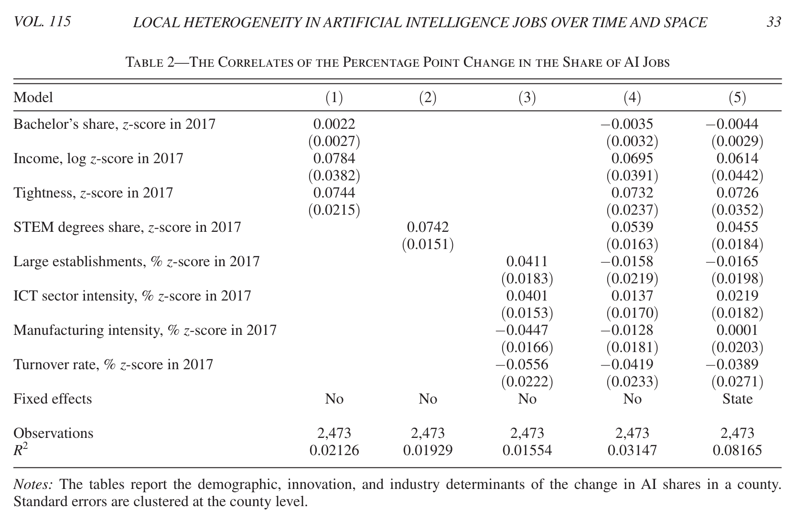
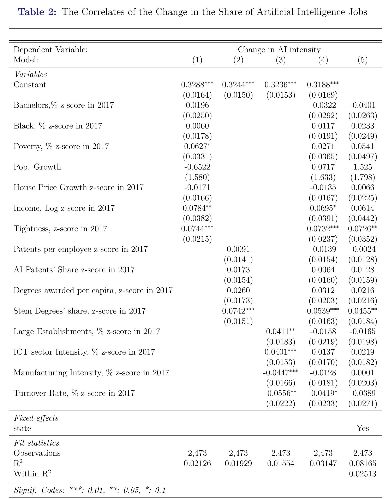

```{r}
#| label: setup
#| include: false
# Load all required packages
library(tidyverse)
library(fixest)
library(modelsummary)
library(kableExtra)
library(sf)
library(scales)
library(tigris)
library(ggplot2)
library(patchwork)
library(grid)
library(png)
library(usmap)
library(viridis)
library(dplyr)
library(forcats)
# Set options
options(tigris_use_cache = TRUE)

# Pin fixest's singleton handling to the behaviour these results were estimated
# under. fixest changed the default for `fixef.rm` in newer releases, which drops
# 8 fixed-effect singleton observations and silently changes every reported
# Num.Obs. (24,645 -> 24,637) without changing any coefficient. Setting it here
# keeps the reported sample sizes reproducible across fixest versions.
fixest::setFixest_estimation(fixef.rm = "none")
data_raw <- read_csv("data.csv")

fmt_est <- function(estimate, se) {
  ifelse(
    is.na(estimate),
    "",
    paste0(sprintf("%.4f", estimate), " (", sprintf("%.4f", se), ")")
  )
}

# ---- Output-format helpers ----
# Word (.docx) output is neither LaTeX nor HTML. kableExtra's styling emits HTML,
# which cannot be embedded in a .docx, so for that target every table is rendered
# as a plain pipe table and its note is appended as a following paragraph. The
# PDF and HTML paths are unchanged.
tbl_format <- function() {
  if (knitr::is_latex_output()) {
    "latex"
  } else if (knitr::is_html_output()) {
    "html"
  } else {
    "pipe"
  }
}

is_docx_out <- function() {
  !knitr::is_latex_output() && !knitr::is_html_output()
}

docx_table <- function(k, note = NULL) {
  txt <- paste(as.character(k), collapse = "
")
  if (!is.null(note) && nzchar(note)) {
    txt <- paste0(txt, "

*Notes:* ", note, "
")
  }
  knitr::asis_output(txt)
}

make_comparison_table <- function(replication_models, coef_map, original_overrides = NULL,
                                  caption, note) {
  estimates <- purrr::imap_dfr(
    replication_models,
    function(model, model_label) {
      broom::tidy(model) %>%
        filter(term %in% names(coef_map)) %>%
        transmute(
          model = model_label,
          term,
          variable = unname(coef_map[term]),
          replication_estimate = estimate,
          replication_se = std.error
        )
    }
  )

  comparison <- estimates %>%
    mutate(
      original_estimate = replication_estimate,
      original_se = replication_se
    )

  if (!is.null(original_overrides)) {
    comparison <- comparison %>%
      left_join(original_overrides, by = c("model", "term"), suffix = c("", "_override")) %>%
      mutate(
        original_estimate = coalesce(original_estimate_override, original_estimate),
        original_se = coalesce(original_se_override, original_se)
      ) %>%
      select(-ends_with("_override"))
  }

  table_format <- tbl_format()

  table_out <- comparison %>%
    mutate(
      `Original` = fmt_est(original_estimate, original_se),
      `Replication` = fmt_est(replication_estimate, replication_se),
      `Difference` = ifelse(
        is.na(original_estimate),
        "",
        sprintf("%.4f", replication_estimate - original_estimate)
      )
    ) %>%
    select(Model = model, Variable = variable, Original, Replication, Difference) %>%
    arrange(Model, factor(Variable, levels = unname(coef_map))) %>%
    knitr::kable(
      format = table_format,
      booktabs = TRUE,
      longtable = FALSE,
      caption = NULL,
      align = c("l", "l", "r", "r", "r"),
      escape = TRUE
    )

  if (is_docx_out()) {
    return(docx_table(table_out, note))
  }

  if (knitr::is_latex_output()) {
    table_out %>%
      kableExtra::kable_styling(
        latex_options = c("hold_position", "scale_down"),
        font_size = 8,
        full_width = FALSE
      ) %>%
      kableExtra::collapse_rows(columns = 1, valign = "top") %>%
      kableExtra::footnote(
        general = note,
        general_title = "Notes: ",
        threeparttable = TRUE,
        escape = TRUE
      )
  } else {
    table_out %>%
      kableExtra::kable_styling(
        bootstrap_options = c("striped", "condensed"),
        font_size = 13,
        full_width = FALSE
      ) %>%
      kableExtra::collapse_rows(columns = 1, valign = "top") %>%
      kableExtra::footnote(
        general = note,
        general_title = "Notes: ",
        escape = TRUE
      )
  }
}
```

*JEL: J24, O33, R11*

*Keywords:* Artificial Intelligence, Regional Economics, Labor Markets

*Data Availability:* Data and code for push-button reproduction of this replication have been deposited with the ZBW Journal Data Archive at https://journaldata.zbw.eu/dataset/andreadis-ai-jobs-replication-data. A development copy is also available at https://github.com/JacobKhay/Andreadis-Replication.


## Abstract {.unnumbered}

We partially replicate @andreadis2025 on the correlation between the level and growth of artificial intelligence job-posting intensity across U.S. counties from 2014 to 2023 and a collection of variables related to education, innovation, and industry. We reproduce AKCLM's Table 1 exactly from the released code and data and reproduce most Table 2 coefficients, with a scaling discrepancy for bachelor's share between the published version of record and the released code; the AEA conference preprint agrees with the code, so the discrepancy is specific to the published article. We also identify a map-construction reproducibility issue for Figure 1. We further show that the published table footers in @andreadis2025 describe the regressions as unweighted even though the released code uses log-posting weights. To assess robustness, we compare unweighted and log-population-weighted versions of the main specifications. Most, but not all, of the associations persist. We critique the construction of a key variable and the authors' unsupported causal claims. 

Declaration: There are no financial conflicts of interest to share. 

\newpage

## Introduction

This paper replicates @andreadis2025, henceforth AKCLM, on the correlation between the level and growth of artificial intelligence employment and education, innovation, and industry factors across U.S. counties from 2014 to 2023. Understanding where AI intensity emerges and how it spreads matters for researchers and policymakers alike: AI has the potential to reshape regional economies [@acemoglu2024; @brynjolfsson2021], alter the demand for skills [@autor2015; @acemoglu2019], and shift patterns of innovation [@babina2024]. 

AKCLM define "AI intensity" as AI-related job postings divided by total job postings in US counties. There are two outcome variables: the level of AI intensity for each county-year and the growth of AI intensity between 2017-2018 and 2022-2023 for each county.

AKCLM link county-level AI intensity to several explanatory factors. Education is captured by the share of adults with a college degree, innovation by local patenting activity [@giczy2022], and industry by the composition of employment across sectors. 

AKCLM find that the level of AI intensity is associated with higher educational attainment, more innovation activity, and certain industry profiles. For the level of AI intensity, bachelor's share and STEM degree share are positively associated, while manufacturing intensity is negatively associated. For the growth of AI intensity, STEM degree share remains significantly correlated, while turnover rate shows a negative association.

We reproduce these results and extend the analysis by comparing unweighted specifications with log-population-weighted specifications. Some associations change in magnitude under alternative weighting schemes, but the pattern is not uniform. For the level of AI intensity, patents per employee shows the most robust association across weighting schemes, while bachelor's share shows the largest magnitude decline. For the growth of AI intensity, STEM degree share shows the most consistent associations, though effect sizes diminish when we weight by log-population.


Finally, AKCLM's causal interpretations are not supported by the observational nature of their data [@holland1986].

## Data

AKCLM utilize multiple data sources to construct a comprehensive county-level dataset spanning 2014–2023:

*AI Job Posting Data*: Lightcast [@beckett2023] aggregates job postings from over 40,000 online job boards, newspapers, and employer websites. AI-related jobs are identified through skills and keywords associated with AI development and use [@acemoglu2022]. The first dependent variable, AI intensity, is defined as:

$$
AI_{it} = \frac{\text{AI job postings}_{it}}{\text{Total job postings}_{it}} \times 100 \tag{1}
$$

AI intensity has a mean of 0.4 percentage points and a standard deviation of 1.1 percentage points across county-year observations.

The second dependent variable captures the percentage point change in AI intensity between the 2017-2018 average and the 2022-2023 average: 

$$
\Delta AI_{i} = \frac{\sum_{t \in \{2022,2023\}} \text{AI}_{it}}{\sum_{t \in \{2022,2023\}} \text{Total}_{it}} - \frac{\sum_{t \in \{2017,2018\}} \text{AI}_{it}}{\sum_{t \in \{2017,2018\}} \text{Total}_{it}} \tag{2}
$$

The change in AI intensity has a mean of 0.3 percentage points and a standard deviation of 1.0 percentage points across counties.

*Demographic Variables*: From the American Community Survey [@census_acs], AKCLM construct several county-level demographic measures, including bachelor's share (percentage of workforce with bachelor's degree or higher), black population share (percentage of county population identifying as Black), poverty share (percentage of population below federal poverty line), log-population (natural logarithm of county population), and log median income (natural logarithm of median household income).

*Innovation Indicators*: AKCLM construct several innovation measures, including patents per employee (USPTO patent counts normalized by employment), AI patents share (percentage of patents classified as AI-related) [@giczy2022], STEM degrees share (percentage of awarded degrees in STEM fields), and degrees per capita (total degrees awarded per capita).

*Industry, Labor Market, and Housing Variables*: AKCLM construct several industry, labor market, and housing measures, including labor market tightness (ratio of job postings to unemployed workers) [@bls_laus], manufacturing intensity (employment share in manufacturing sector) [@census_cbp], ICT intensity (employment share in information and communication technology), turnover rate (worker separation rate from Quarterly Workforce Indicators) [@census_qwi], large establishments share (percentage of employment in large firms), and house price growth from the Federal Housing Finance Agency [@bogin2019].

All explanatory variables are lagged by one year. 


An important statistical issue arises from the construction of labor market tightness. AI intensity is defined as AI job postings divided by total job postings, while labor market tightness is constructed as total job postings divided by unemployed workers. Total job postings thus appears in the denominator of the dependent variable and in the numerator of a key regressor.

This creates denominator contamination, or a ratio-induced mechanical relationship: both sides of the regression share the same underlying quantity, inducing a correlation that exists purely through algebraic construction. Holding AI postings and unemployment fixed, an increase in total postings lowers AI intensity and raises labor market tightness, implying a negative mechanical relationship. AKCLM's preferred tightness coefficient is positive, so this particular mechanical channel would work against the reported positive sign rather than mechanically generating it.


$$
\frac{\text{AI job postings}_{it}}{\text{Total job postings}_{it}} = \alpha + \beta \frac{\text{Total job postings}_{it}}{\text{Unemployed}_{it}} + X'_{it}\gamma + \varepsilon_{it} \tag{3}
$$

This can still affect coefficient estimates and should be reported transparently. The issue is analogous to regressing $Y/Z$ on $Z/X$ where the shared $Z$ induces correlation even when $Y$ and $X$ are actually independent. Kronmal [-@kronmal1993spurious] shows that when the dependent variable is a ratio sharing a component with an independent variable, "regression coefficient estimates for the other independent variables ... result in inappropriate conclusions." 

## Replication

We use R [@ihaka1996r] and the tidyverse collection of packages [@tidyverse]. To estimate and display regression models, we use fixest [@fixest] and modelsummary [@modelsummary].

Our reproduction begins from the intermediate replication materials released with AKCLM: the authors' `data.csv` and `replication_code.R` from the openICPSR archive. We do not reconstruct the full county-year dataset from the underlying raw sources such as Lightcast, ACS, QWI, CBP, LAUS, FHFA, and patent records. Instead, we treat AKCLM's released `data.csv` as the analysis-ready input and rerun the estimation and figure-construction steps from that point. For Tables 1 and 2, we recreate the variables, samples, standardization, weights, fixed effects, and model specifications from the published replication code, then compare the resulting estimates with the published tables. For Figure 1, the archive does not include code that directly generates the published maps. We therefore compare the published figure image with maps generated from the released data and the definitions stated in the article.

For comparability with AKCLM, the main-text reproduction tables follow AKCLM's reporting convention and display variables that have statistically significant coefficients in at least one model specification. Full unselected regression output for all variables appears in the appendix.

### Table 1

The core model for the level of AI intensity is a two-way fixed-effects regression:

$$
AI_{it} = \alpha_i + \alpha_t + \boldsymbol{\beta}' \mathbf{X}_{it-1} + \varepsilon_{it} \tag{4}
$$

where $\alpha_i$ and $\alpha_t$ are county and year fixed effects, $\mathbf{X}_{it-1}$ is a vector of standardized regressors lagged one year, and $\varepsilon_{it}$ is an error term clustered at the county level.

We reproduce Table 1 from AKCLM. All coefficients and standard errors match the original results when we retain the weighting used in AKCLM's released code.

```{r}
#| label: tbl-table1
#| echo: false
#| warning: false
#| message: false
#| tbl-cap: "AKCLM and replication estimates for the level of AI intensity"
#| tbl-cap-location: top
#| tbl-pos: "H"

# ── Construct all variables in one pipeline ──

data_ai <- data_raw %>%
  mutate(
    state_year            = paste0(state, Year),
    ai_intensity          = ai / nads,
    logincome             = log(medhhincome),
    logpop                = log(pop),
    logemp                = log(Employed),
    lads                  = log(1 + nads),
    pat_intensity         = n_inventors / Employed,
    patai_intensity       = replace_na(ai_patents / n_patents, 0),
    large_firms           = 1 - (small + medium) / est,
    information_intensity = replace_na(information_emp / emp, 0),
    manuf_intensity       = manuf_emp / emp,
    degshare              = (udeg + mdeg) / Employed,
    stemshare             = replace_na((ustemdeg + mstemdeg) / (udeg + mdeg), 0),
    tightness             = nads / Unemployed,
    hpi_ch                = hpi_ch / 100
  )

# ── Standardize, saving raw values for extension weighting ──

data_ai_z <- data_ai %>%
  filter(emp != 0) %>%
  mutate(
    pop_raw    = pop,
    logpop_raw = logpop,
    logemp_raw = logemp
  ) %>%
  mutate(
    share_bac             = as.numeric(scale(share_bac)),
    share_black           = as.numeric(scale(share_black)),
    share_poverty         = as.numeric(scale(share_poverty)),
    logpop                = as.numeric(scale(logpop)),
    hpi_ch                = as.numeric(scale(hpi_ch)),
    logincome             = as.numeric(scale(logincome)),
    tightness             = as.numeric(scale(tightness)),
    unrate                = as.numeric(scale(unrate)),
    pat_intensity         = as.numeric(scale(pat_intensity)),
    patai_intensity       = as.numeric(scale(patai_intensity)),
    degshare              = as.numeric(scale(degshare)),
    stemshare             = as.numeric(scale(stemshare)),
    large_firms           = as.numeric(scale(large_firms)),
    information_intensity = as.numeric(scale(information_intensity)),
    manuf_intensity       = as.numeric(scale(manuf_intensity)),
    TurnOvrS              = as.numeric(scale(TurnOvrS))
  ) %>%
  mutate(ai_intensity = ai_intensity * 100)

# ── Common sample ──

data_ai_z_complete <- data_ai_z %>%
  drop_na(share_bac, share_black, share_poverty, logpop, hpi_ch, logincome,
          tightness, pat_intensity, patai_intensity, degshare, stemshare,
          large_firms, information_intensity, manuf_intensity, TurnOvrS)

# ── Regressions ──

est_demog <- feols(
  ai_intensity ~ share_bac + share_black + share_poverty + logpop + hpi_ch +
    logincome + tightness | Year + COUNTY_FIPS,
  data = data_ai_z_complete, cluster = "COUNTY_FIPS", weights = ~lads
)

est_innov <- feols(
  ai_intensity ~ pat_intensity + patai_intensity + degshare + stemshare |
    Year + COUNTY_FIPS,
  data = data_ai_z_complete, cluster = "COUNTY_FIPS", weights = ~lads
)

est_indus <- feols(
  ai_intensity ~ large_firms + information_intensity + manuf_intensity +
    TurnOvrS | Year + COUNTY_FIPS,
  data = data_ai_z_complete, cluster = "COUNTY_FIPS", weights = ~lads
)

est_all <- feols(
  ai_intensity ~ share_bac + share_black + share_poverty + logpop + hpi_ch +
    logincome + tightness + pat_intensity + patai_intensity + degshare +
    stemshare + large_firms + information_intensity + manuf_intensity +
    TurnOvrS | Year + COUNTY_FIPS,
  data = data_ai_z, cluster = "COUNTY_FIPS", weights = ~lads
)

est_all_unweighted_footer <- feols(
  ai_intensity ~ share_bac + share_black + share_poverty + logpop + hpi_ch +
    logincome + tightness + pat_intensity + patai_intensity + degshare +
    stemshare + large_firms + information_intensity + manuf_intensity +
    TurnOvrS | Year + COUNTY_FIPS,
  data = data_ai_z, cluster = "COUNTY_FIPS"
)

est_all_no_tightness_code_weight <- feols(
  ai_intensity ~ share_bac + share_black + share_poverty + logpop + hpi_ch +
    logincome + pat_intensity + patai_intensity + degshare +
    stemshare + large_firms + information_intensity + manuf_intensity +
    TurnOvrS | Year + COUNTY_FIPS,
  data = data_ai_z, cluster = "COUNTY_FIPS", weights = ~lads
)

est_all_sy <- feols(
  ai_intensity ~ share_bac + share_black + share_poverty + logpop + hpi_ch +
    logincome + tightness + pat_intensity + patai_intensity + degshare +
    stemshare + large_firms + information_intensity + manuf_intensity +
    TurnOvrS | state_year + COUNTY_FIPS,
  data = data_ai_z, vcov = "twoway", weights = ~lads
)

# ── Side-by-side comparison table ──

labels_t1 <- c(
  "share_bac"             = "Bachelor's share",
  "hpi_ch"                = "House price growth",
  "tightness"             = "Labor tightness",
  "pat_intensity"         = "Patents per employee",
  "stemshare"             = "STEM degrees share",
  "information_intensity" = "ICT sector intensity",
  "manuf_intensity"       = "Manufacturing intensity",
  "TurnOvrS"              = "Turnover rate"
)

t1_models <- list(
  "(1) Demographics" = est_demog,
  "(2) Innovation" = est_innov,
  "(3) Industry" = est_indus,
  "(4) All controls" = est_all,
  "(5) State-year FE" = est_all_sy
)

make_comparison_table(
  replication_models = t1_models,
  coef_map = labels_t1,
  caption = "AKCLM and replication estimates for the level of AI intensity",
  note = paste(
    "Each cell reports coefficient and standard error in parentheses.",
    "The original column reports published AKCLM values; the replication column reruns AKCLM's released code and data.",
    "These estimates use AKCLM's code weighting, log(1 + job postings), despite the published table footer describing the observations as unweighted.",
    "The dependent variable is AI intensity in percentage points.",
    "Columns 1-4 include county and year fixed effects; column 5 includes county and state-year fixed effects.",
    "All explanatory variables are standardized and lagged by one year."
  )
)
```

Table 1 presents parameter estimates for five models, each using AI intensity as the outcome, which has a mean of 0.4 percentage points and a standard deviation of 1.1 percentage points across county-year observations. All regressors are standardized. Column 4 (the preferred specification) includes the full control set with county and year fixed effects; all subsequent discussion refers to this column.

AKCLM's released code applies log-posting weights in every Table 1 regression (`weights = ~lads`, where `lads = log(1 + nads)`). This contradicts the published Table 1 footer, which describes the observations as unweighted. The table below reports the impact of this discrepancy for AKCLM's preferred Model 4. The core signs and significance patterns for bachelor's share, labor market tightness, STEM degree share, patents per employee, and manufacturing remain intact under the estimator described in the footer. However, the unweighted magnitudes are generally smaller, and two marginal coefficients in the weighted code specification, house price growth and ICT sector intensity, are no longer statistically significant.

```{r}
#| label: tbl-table1-footer-check
#| echo: false
#| warning: false
#| message: false
#| tbl-cap: "AKCLM Table 1 Model 4: log(postings) weighted versus unweighted"
#| tbl-cap-location: top
#| tbl-pos: "H"

footer_terms <- c(
  "share_bac" = "Bachelor's share",
  "tightness" = "Labor tightness",
  "stemshare" = "STEM degrees share",
  "pat_intensity" = "Patents per employee",
  "manuf_intensity" = "Manufacturing intensity",
  "hpi_ch" = "House price growth",
  "information_intensity" = "ICT sector intensity"
)

footer_check <- tibble(
  term = names(footer_terms),
  Variable = unname(footer_terms),
  `Log(postings) weighted` = fmt_est(coef(est_all)[term], se(est_all)[term]),
  `Unweighted` = fmt_est(coef(est_all_unweighted_footer)[term], se(est_all_unweighted_footer)[term])
) %>%
  select(-term)

footer_kable <- knitr::kable(
  footer_check,
  format = tbl_format(),
  booktabs = TRUE,
  caption = NULL,
  align = c("l", "r", "r")
)

if (is_docx_out()) {
  docx_table(footer_kable)
} else {
  footer_kable %>%
    kableExtra::kable_styling(
      latex_options = c("hold_position", "scale_down"),
      bootstrap_options = c("striped", "hover", "condensed"),
      font_size = 8
    )
}
```

The denominator-contamination concern is about labor market tightness specifically. To quantify whether that concern changes the other preferred Model 4 estimates, the table below compares AKCLM's code-weighted preferred Model 4 with the same model after removing only labor market tightness. The largest absolute movement is for bachelor's share, which changes from 0.1817 to 0.2512. The other highlighted coefficients move less in absolute terms: patents per employee changes from 0.0295 to 0.0272, STEM degree share from 0.0475 to 0.0585, ICT intensity from 0.0258 to 0.0173, manufacturing from -0.0333 to -0.0453, and turnover from 0.0188 to 0.0345. Thus, removing tightness changes some magnitudes but does not overturn the main non-tightness associations in AKCLM's preferred levels model.

```{r}
#| label: tbl-tightness-removal
#| echo: false
#| warning: false
#| message: false
#| tbl-cap: "AKCLM Table 1 Model 4 with and without labor market tightness"
#| tbl-cap-location: top
#| tbl-pos: "H"

tightness_terms <- c(
  "share_bac" = "Bachelor's share",
  "stemshare" = "STEM degrees share",
  "pat_intensity" = "Patents per employee",
  "manuf_intensity" = "Manufacturing intensity",
  "hpi_ch" = "House price growth",
  "information_intensity" = "ICT sector intensity",
  "TurnOvrS" = "Turnover rate"
)

tightness_removal <- tibble(
  term = names(tightness_terms),
  Variable = unname(tightness_terms),
  `With tightness` = fmt_est(coef(est_all)[term], se(est_all)[term]),
  `Without tightness` = fmt_est(coef(est_all_no_tightness_code_weight)[term], se(est_all_no_tightness_code_weight)[term]),
  `Coefficient change` = sprintf("%.4f", coef(est_all_no_tightness_code_weight)[term] - coef(est_all)[term])
) %>%
  select(-term)

tightness_note <- "Both models use AKCLM's released-code log-posting weights, county fixed effects, and year fixed effects. The table reports the movement in other highlighted coefficients when labor market tightness is removed from the preferred levels specification."

tightness_kable <- knitr::kable(
  tightness_removal,
  format = tbl_format(),
  booktabs = TRUE,
  caption = NULL,
  align = c("l", "r", "r", "r")
)

if (is_docx_out()) {
  docx_table(tightness_kable, tightness_note)
} else {
  tightness_kable %>%
    kableExtra::kable_styling(
      latex_options = c("hold_position", "scale_down"),
      bootstrap_options = c("striped", "hover", "condensed"),
      font_size = 8
    ) %>%
    kableExtra::footnote(
      general = tightness_note,
      general_title = "Notes: ",
      threeparttable = knitr::is_latex_output(),
      escape = TRUE
    )
}
```

Bachelor's share (0.18, p < 0.001) is the largest demographic predictor of AI intensity. Two counties differing by one standard deviation in bachelor's share are expected to differ by 0.18 percentage points in AI intensity, which is 42% of the mean and 16% of the standard deviation.

Among the innovation variables, STEM degree share (0.048, p < 0.05) carries a coefficient 62% larger than patents per employee (0.029, p < 0.01). Two counties differing by one standard deviation in STEM degree share are expected to differ by 0.048 percentage points in AI intensity (11% of the mean and 4% of the standard deviation), compared with 0.029 percentage points for patents per employee (7% of the mean, 3% of the standard deviation). 

Among industry variables, ICT intensity (0.026, p = 0.058) and manufacturing intensity (−0.033, p < 0.01) exhibit similar effect sizes but opposite signs. Two counties differing by one standard deviation in manufacturing intensity are expected to differ by 0.033 percentage points (8% of the standard deviation), compared with 0.026 percentage points for ICT intensity (6% of the standard deviation). 

### AKCLM Table 2: Growth of AI Intensity

For the growth of AI intensity, we estimate a cross-sectional OLS regression with no fixed effects:

$$
\Delta AI_{i} = \beta_0 + \boldsymbol{\beta}' \mathbf{X}_{i,2017} + \varepsilon_{i} \tag{5}
$$

where $\Delta AI_{i}$ is the percentage point change in AI intensity between the 2017–2018 and 2022–2023 averages, $\beta_0$ is a constant term representing expected AI intensity growth when all predictors are at their mean, $\mathbf{X}_{i,2017}$ is a vector of standardized regressors measured in 2017, and $\varepsilon_{i}$ is an error term clustered at the county level. Unlike equation (3), there is no time subscript $t$ because the growth of AI intensity is a single observation per county — the change between two pooled periods — rather than a panel. This model does not include county or year fixed effects, as the outcome is already a first difference across counties.

We reproduce AKCLM's Table 2 by rerunning the released code with AKCLM's released `data.csv`. The growth replication table below labels the two sources separately: the "Original" column transcribes the published version of record --- @andreadis2025, *AEA Papers and Proceedings* 115: 29--34, DOI 10.1257/pandp.20251001, Table 2 on page 33 --- while the "Replication" column reports our rerun of AKCLM's released code and data. A page image of that published table is reproduced in the appendix as @fig-akclm-published-table2. Identifying the version matters here, because AKCLM circulated in more than one form and the bachelor's-share row differs between them; we return to this below. The bachelor's-share variable used here is read directly from AKCLM's released `data.csv`; we do not rebuild it from ACS tables. In the released data, the 2017 raw `share_bac` variable has 3,130 county observations, a mean of 0.2076, and a standard deviation of 0.0911. The AKCLM Table 2 sample follows AKCLM's code restriction that keeps counties with growth in AI intensity between -5 and 10 percentage points before applying the complete-case restrictions. After AKCLM's z-scoring and AKCLM Table 2 sample restrictions, the regression sample has 2,473 observations, with mean 0.0442 and standard deviation 0.9938 for standardized `share_bac14`.

All rerun results match the published table except for the coefficient and standard error for bachelor's share in the models where it appears. In columns 1, 4, and 5 the published version of record reports 0.0022 (0.0027), -0.0035 (0.0032), and -0.0044 (0.0029), while rerunning the released code gives 0.0196 (0.0250), -0.0322 (0.0292), and -0.0401 (0.0263).

This difference is specific to the published article, and it is worth stating which document each figure comes from. The preprint distributed through the AEA conference program, marked "Forthcoming in AEA P&P 2025", reports 0.0196 (0.0250), -0.0322 (0.0292), and -0.0401 (0.0263) in the corresponding row of its Table 2. Those are exactly the values the released code produces. In the preprint, therefore, table and code agree and no discrepancy arises; the same is true of the SSRN version. A reader working from either of those documents will not reproduce the finding reported here. The discrepancy is between the published version of record and the released replication code. Both versions of the row are reproduced in the appendix, @fig-akclm-published-table2 and @fig-akclm-preprint-table2.

The mechanical source of the difference is a change of scale. In the released `data.csv` the 2017 `share_bac` variable has a standard deviation of 0.0911, or 9.114 percentage points. Dividing each preprint coefficient by 9.114 returns the published coefficient in every column: 0.0196 gives 0.00215 against a published 0.0022, -0.0322 gives -0.00353 against -0.0035, and -0.0401 gives -0.00440 against -0.0044. The agreement holds to the displayed precision in all three columns. The published row is therefore expressed per percentage point of bachelor's share, whereas the released code z-scores `share_bac14` and the preprint row is expressed per standard deviation. The row label reads "Bachelor's share, z-score in 2017" in the published table, as it did in the preprint, so the published coefficient is reported on a different scale from the one its own label describes and from the one used by every other row of that table. Random spot checks of the 2017 `share_bac` values in `data.csv` produced plausible county proportions, so the underlying data file appears correct to us. We do not claim to know how the rescaling occurred, and the authors did not respond to our question about this point; our interpretation is simply that the published row and the released code cannot both describe the same specification.

AKCLM's released Table 2 code also uses log-posting weights (`weights = ~lads14`), although the published Table 2 footer describes the observations as unweighted.

```{r}
#| label: tbl-table2
#| echo: false
#| warning: false
#| message: false
#| tbl-cap: "AKCLM and replication estimates for the growth of AI intensity"
#| tbl-cap-location: top
#| tbl-pos: "H"

# ── Build cross-sectional growth dataset from the single data load ──

data_ai_growth <- data_raw %>%
  filter(Year %in% c(2017, 2018, 2022, 2023)) %>%
  mutate(
    state_year = paste0(state, Year),
    new        = as.integer(Year > 2020)
  ) %>%
  group_by(new, COUNTY_FIPS) %>%
  mutate(ai = sum(ai), nads = sum(nads), ai_intensity = ai / nads) %>%
  filter(Year %in% c(2017, 2022)) %>%
  ungroup()

# ── Construct variables and create lagged (2017) values ──

data_ai_growth <- data_ai_growth %>%
  mutate(
    logincome             = log(medhhincome),
    logpop                = log(pop),
    logemp                = log(Employed),
    lads                  = log(1 + nads),
    pat_intensity         = n_inventors / Employed,
    patai_intensity       = replace_na(ai_patents / n_patents, 0),
    large_firms           = 1 - (small + medium) / est,
    information_intensity = information_emp / emp,
    manuf_intensity       = manuf_emp / emp,
    degshare              = (udeg + mdeg) / Employed,
    stemshare             = replace_na((ustemdeg + mstemdeg) / (udeg + mdeg), 0),
    tightness             = nads / Unemployed,
    hpi_ch                = hpi_ch / 100
  ) %>%
  group_by(COUNTY_FIPS) %>%
  mutate(
    dai_intensity9          = ai_intensity - lag(ai_intensity, 1),
    gpop                    = (logpop - lag(logpop, 1)) / 5,
    share_bac14             = lag(share_bac, 1),
    share_black14           = lag(share_black, 1),
    share_poverty14         = lag(share_poverty, 1),
    pop14                   = lag(pop, 1),
    logpop14_raw            = lag(logpop, 1),
    logpop14                = lag(logpop, 1),
    hpi_ch14                = lag(hpi_ch, 1),
    logincome14             = lag(logincome, 1),
    tightness14             = lag(tightness, 1),
    pat_intensity14         = lag(pat_intensity, 1),
    patai_intensity14       = lag(patai_intensity, 1),
    degshare14              = lag(degshare, 1),
    stemshare14             = lag(stemshare, 1),
    large_firms14           = lag(large_firms, 1),
    information_intensity14 = lag(information_intensity, 1),
    manuf_intensity14       = lag(manuf_intensity, 1),
    TurnOvrS14              = lag(TurnOvrS, 1),
    lads14                  = lag(lads, 1),
    unrate14                = lag(unrate, 1)
  ) %>%
  ungroup()

# ── Standardize lagged predictors and scale outcome ──

data_ai_l_z <- data_ai_growth %>%
  filter(emp != 0) %>%
  drop_na(share_bac14) %>%
  mutate(
    share_bac14             = scale(share_bac14),
    share_black14           = scale(share_black14),
    share_poverty14         = scale(share_poverty14),
    logpop14                = scale(logpop14),
    hpi_ch14                = scale(hpi_ch14),
    logincome14             = scale(logincome14),
    tightness14             = scale(tightness14),
    pat_intensity14         = scale(pat_intensity14),
    patai_intensity14       = scale(patai_intensity14),
    degshare14              = scale(degshare14),
    stemshare14             = scale(stemshare14),
    large_firms14           = scale(large_firms14),
    information_intensity14 = scale(information_intensity14),
    manuf_intensity14       = scale(manuf_intensity14),
    TurnOvrS14              = scale(TurnOvrS14),
    unrate14                = scale(unrate14),
    dai_intensity9          = dai_intensity9 * 100
  )

# ── Common sample ──

data_t2 <- data_ai_l_z %>%
  filter(dai_intensity9 > -5, dai_intensity9 < 10) %>%
  drop_na(share_bac14, share_black14, share_poverty14, logpop14, hpi_ch14,
          logincome14, tightness14, pat_intensity14, patai_intensity14,
          degshare14, stemshare14, large_firms14, information_intensity14,
          manuf_intensity14, TurnOvrS14)

data_t2_unrestricted <- data_ai_l_z %>%
  drop_na(share_bac14, share_black14, share_poverty14, logpop14, hpi_ch14,
          logincome14, tightness14, pat_intensity14, patai_intensity14,
          degshare14, stemshare14, large_firms14, information_intensity14,
          manuf_intensity14, TurnOvrS14)

# ── Regressions ──

est_t2_demog <- feols(
  dai_intensity9 ~ share_bac14 + share_black14 + share_poverty14 + gpop +
    hpi_ch14 + logincome14 + tightness14,
  data = data_t2, weights = ~lads14
)

est_t2_innov <- feols(
  dai_intensity9 ~ pat_intensity14 + patai_intensity14 + degshare14 + stemshare14,
  data = data_t2, weights = ~lads14
)

est_t2_indus <- feols(
  dai_intensity9 ~ large_firms14 + information_intensity14 + manuf_intensity14 +
    TurnOvrS14,
  data = data_t2, weights = ~lads14
)

est_t2_all <- feols(
  dai_intensity9 ~ share_bac14 + share_black14 + share_poverty14 + gpop +
    hpi_ch14 + logincome14 + tightness14 + pat_intensity14 +
    patai_intensity14 + degshare14 + stemshare14 + large_firms14 +
    information_intensity14 + manuf_intensity14 + TurnOvrS14,
  data = data_t2, weights = ~lads14
)

est_t2_all_state <- feols(
  dai_intensity9 ~ share_bac14 + share_black14 + share_poverty14 + gpop +
    hpi_ch14 + logincome14 + tightness14 + pat_intensity14 +
    patai_intensity14 + degshare14 + stemshare14 + large_firms14 +
    information_intensity14 + manuf_intensity14 + TurnOvrS14 | state,
  # Cluster explicitly by state. Newer fixest versions no longer fall back to
  # clustering on the first fixed effect, so leaving this implicit changed the
  # standard errors in this column.
  data = data_t2, weights = ~lads14, cluster = "state"
)

est_t2_all_unrestricted <- feols(
  dai_intensity9 ~ share_bac14 + share_black14 + share_poverty14 + gpop +
    hpi_ch14 + logincome14 + tightness14 + pat_intensity14 +
    patai_intensity14 + degshare14 + stemshare14 + large_firms14 +
    information_intensity14 + manuf_intensity14 + TurnOvrS14,
  data = data_t2_unrestricted, weights = ~lads14
)

# ── Side-by-side comparison table ──

labels_t2 <- c(
  "share_bac14"             = "Bachelor's share",
  "logincome14"             = "Income, log",
  "tightness14"             = "Labor tightness",
  "stemshare14"             = "STEM degrees share",
  "large_firms14"           = "Large establishments",
  "information_intensity14" = "ICT sector intensity",
  "manuf_intensity14"       = "Manufacturing intensity",
  "TurnOvrS14"              = "Turnover rate"
)

t2_models <- list(
  "(1) Demographics" = est_t2_demog,
  "(2) Innovation" = est_t2_innov,
  "(3) Industry" = est_t2_indus,
  "(4) All controls" = est_t2_all,
  "(5) State FE" = est_t2_all_state
)

published_t2_overrides <- tribble(
  ~model, ~term, ~original_estimate, ~original_se,
  "(1) Demographics", "share_bac14",  0.0022, 0.0027,
  "(4) All controls", "share_bac14", -0.0035, 0.0032,
  "(5) State FE",     "share_bac14", -0.0044, 0.0029
)

make_comparison_table(
  replication_models = t2_models,
  coef_map = labels_t2,
  original_overrides = published_t2_overrides,
  caption = "AKCLM and replication estimates for the growth of AI intensity",
  note = paste(
    "Each cell reports coefficient and standard error in parentheses.",
    "The original column transcribes the published version of record (Andreadis et al. 2025, AEA Papers and Proceedings 115: 29-34, DOI 10.1257/pandp.20251001, Table 2, page 33); the replication column reports estimates from the released replication code and data.",
    "The AEA conference preprint and the SSRN version report the same bachelor's-share values as the released code, so the discrepancy shown here arises only against the published version.",
    "The displayed discrepancy is confined to bachelor's share in columns 1, 4, and 5.",
    "The replication estimates use AKCLM's code weighting, log(1 + 2017 job postings), despite the published table footer describing the observations as unweighted.",
    "The dependent variable is the percentage-point change in AI intensity between the 2017-2018 and 2022-2023 averages.",
    "Columns 1-4 have no fixed effects; column 5 includes state fixed effects."
  )
)
```

AKCLM's Table 2 analyzes predictors of the growth of AI intensity between 2017–2018 and 2022–2023; in this paper, those results appear in the growth replication table above. All regressors are standardized, with explanatory variables measured in 2017. Column 4 includes the full control set and serves as the preferred specification; all subsequent discussion refers to this column.

STEM degree share (0.054, p < 0.01) is the largest statistically significant predictor of AI intensity growth in the preferred specification. Two counties differing by one standard deviation in STEM degree share are expected to differ by 0.054 percentage points in AI intensity growth, equivalent to 61% of the median of 0.088 percentage points.

Among labor market variables, turnover rate (−0.042, p < 0.01) carries a coefficient 2.7 times larger in magnitude than large establishment share (−0.016, p = 0.47). Two counties differing by one standard deviation in turnover rate are expected to differ by 0.042 percentage points in AI intensity growth (48% of the median), compared with 0.016 percentage points for large establishment share (18% of the median).

```{r}
#| label: fig-map-side-by-side
#| echo: false
#| message: false
#| warning: false
#| fig-cap: "Published and reconstructed county maps of AI intensity"
#| fig-cap-location: top
#| fig-pos: "H"
#| fig-width: 19
#| fig-height: 13.5

library(tidyverse)
library(sf)
library(tigris)
library(patchwork)

figure_data <- data_raw %>%
  filter(COUNTY_FIPS != 9999) %>%
  filter(!(COUNTY_FIPS >= 9110 & COUNTY_FIPS <= 9190))

panel_a_values <- figure_data %>%
  mutate(aiInt = if_else(nads > 0, ai / nads, NA_real_)) %>%
  group_by(COUNTY_FIPS) %>%
  summarise(aiInt = mean(aiInt, na.rm = TRUE), .groups = "drop")

panel_b_akclm_values <- figure_data %>%
  filter(Year > 2017) %>%
  arrange(COUNTY_FIPS, Year) %>%
  mutate(aiInt = if_else(nads > 0, ai / nads, NA_real_)) %>%
  group_by(COUNTY_FIPS) %>%
  summarise(aiIntch = last(aiInt) - first(aiInt), .groups = "drop")

panel_b_replication_values <- figure_data %>%
  mutate(
    year_group = case_when(
      Year %in% c(2017, 2018) ~ "2017-2018",
      Year %in% c(2022, 2023) ~ "2022-2023",
      TRUE ~ NA_character_
    )
  ) %>%
  filter(!is.na(year_group)) %>%
  group_by(COUNTY_FIPS, year_group) %>%
  summarise(
    ai_sum = sum(ai, na.rm = TRUE),
    nads_sum = sum(nads, na.rm = TRUE),
    .groups = "drop"
  ) %>%
  mutate(aiInt = if_else(nads_sum > 0, ai_sum / nads_sum, NA_real_)) %>%
  pivot_wider(
    id_cols = COUNTY_FIPS,
    names_from = year_group,
    values_from = aiInt
  ) %>%
  mutate(aiIntch = `2022-2023` - `2017-2018`) %>%
  select(COUNTY_FIPS, aiIntch)

# ---- Colour bins aligned with the published AKCLM Figure 1 legend ----
# The cut-offs are exactly those printed in the published legend. They are applied
# as half-open intervals [lower, upper) with open-ended outermost bins so that
# (i) a county sitting exactly on a cut-off is assigned deterministically instead
# of falling through to "No data", and (ii) counties beyond the range spanned by
# the published end labels are still drawn in the extreme bins rather than being
# dropped. Under the previous strict inequalities four counties with valid Panel B
# values (FIPS 08065, 28019, 29125, 29167) were rendered as "No data". Only
# genuinely missing values are shown as "No data" now, which is what makes the
# side-by-side comparison with the published panels informative.

breaks_avg <- c(-Inf, 0.06, 0.14, 0.23, 0.37, 0.71, Inf)
labels_avg <- c("0 - 0.06", "0.06 - 0.14", "0.14 - 0.23",
                "0.23 - 0.37", "0.37 - 0.71", "0.71 - 10")

breaks_chg <- c(-Inf, -0.12, 0, 0.09, 0.24, 0.57, Inf)
labels_chg <- c("-5.56 - -0.12", "-0.12 - 0", "0 - 0.09",
                "0.09 - 0.24", "0.24 - 0.57", "0.57 - 12.35")

panel_a_bins <- panel_a_values %>%
  mutate(fips = str_pad(as.character(COUNTY_FIPS), 5, "left", "0")) %>%
  mutate(ai_share = aiInt * 100) %>%
  mutate(avg_bin = as.character(
    cut(ai_share, breaks = breaks_avg, labels = labels_avg, right = FALSE)
  )) %>%
  mutate(avg_bin = replace_na(avg_bin, "No data"))

bin_panel_b <- function(data) {
  data %>%
    mutate(fips = str_pad(as.character(COUNTY_FIPS), 5, "left", "0")) %>%
    mutate(change_in_share = aiIntch * 100) %>%
    mutate(chg_bin = as.character(
      cut(change_in_share, breaks = breaks_chg, labels = labels_chg, right = FALSE)
    )) %>%
    mutate(chg_bin = replace_na(chg_bin, "No data"))
}

panel_b_akclm_bins <- bin_panel_b(panel_b_akclm_values)
panel_b_replication_bins <- bin_panel_b(panel_b_replication_values)

options(tigris_use_cache = TRUE)
counties <- suppressMessages(
  tigris::counties(cb = TRUE, year = 2020, class = "sf")
) %>%
  mutate(COUNTY_FIPS = GEOID) %>%
  filter(!str_starts(COUNTY_FIPS, "72")) %>%
  st_transform(crs = 4326)

levels_avg_display <- c("0.71 - 10", "0.37 - 0.71", "0.23 - 0.37",
                        "0.14 - 0.23", "0.06 - 0.14", "0 - 0.06", "No data")
levels_chg_display <- c("0.57 - 12.35", "0.24 - 0.57", "0.09 - 0.24",
                        "0 - 0.09", "-0.12 - 0", "-5.56 - -0.12", "No data")

colors_avg_display <- c("#800026", "#e31a1c", "#fd8d3c", "#fed976", "#ffeda0", "#ffffcc", "gray90")
colors_chg_display <- c("#800026", "#fc4e2a", "#fd8d3c", "#fed976", "#ffeda0", "#ffffcc", "gray90")

map_join <- function(values, fill_col, levels) {
  counties %>%
    left_join(values, by = c("COUNTY_FIPS" = "fips")) %>%
    mutate("{fill_col}" := factor(replace_na(.data[[fill_col]], "No data"), levels = levels)) %>%
    tigris::shift_geometry()
}

map_a_akclm <- map_join(panel_a_bins, "avg_bin", levels_avg_display)
map_a_replication <- map_join(panel_a_bins, "avg_bin", levels_avg_display)
map_b_akclm <- map_join(panel_b_akclm_bins, "chg_bin", levels_chg_display)
map_b_replication <- map_join(panel_b_replication_bins, "chg_bin", levels_chg_display)

# ---- Shared legend specification ----
# The published panels (A and C) and the replication panels (B and D) must carry
# an identical key, so the fill scale, the guide, and the legend theme are
# defined once here and reused by both the reconstructed maps and the
# published-image panels rather than being written out twice.

legend_key_w <- unit(1.3, "cm")
legend_key_h <- unit(0.45, "cm")

bin_guide <- guide_legend(
  title = NULL, nrow = 2, byrow = TRUE,
  label.position = "bottom",
  keywidth = legend_key_w, keyheight = legend_key_h,
  label.hjust = 0.5,
  override.aes = list(color = "black", linewidth = 0.3)
)

bin_fill_scale <- function(bin_levels, bin_colors) {
  scale_fill_manual(
    values = setNames(bin_colors, bin_levels),
    breaks = bin_levels, drop = FALSE,
    guide = bin_guide
  )
}

legend_theme <- theme(
  legend.position = "bottom",
  legend.direction = "horizontal",
  legend.text = element_text(size = 14, margin = margin(t = 2, b = 2, l = 1, r = 1)),
  legend.title = element_blank(),
  legend.key.width = legend_key_w,
  legend.key.height = legend_key_h,
  legend.spacing.x = unit(0.2, "cm"),
  legend.margin = margin(t = 4, b = 2),
  legend.key = element_rect(color = "black", linewidth = 0.3)
)

panel_theme <- theme(
  plot.margin = margin(4, 4, 12, 4, "pt"),
  panel.background = element_rect(fill = "white", color = NA),
  plot.background = element_rect(fill = "white", color = NA),
  panel.border = element_rect(color = "gray45", fill = NA, linewidth = 0.35),
  plot.title = element_text(size = 15, hjust = 0.5, margin = margin(b = 5))
)

map_theme <- theme_void() + legend_theme + panel_theme

make_bin_map <- function(map_data, fill_col, title, bin_levels, bin_colors) {
  ggplot(map_data) +
    geom_sf(aes(fill = .data[[fill_col]]), color = "white", size = 0.1) +
    bin_fill_scale(bin_levels, bin_colors) +
    coord_sf(crs = st_crs(map_data), expand = FALSE, clip = "off",
             xlim = c(-2800000, 2500000), ylim = c(-2300000, 1600000)) +
    labs(title = title) +
    map_theme
}

make_avg_map <- function(map_data, title) {
  make_bin_map(map_data, "avg_bin", title, levels_avg_display, colors_avg_display)
}

make_chg_map <- function(map_data, title) {
  make_bin_map(map_data, "chg_bin", title, levels_chg_display, colors_chg_display)
}

# The published panels are raster images cropped from the article, so they carry
# no key of their own. A zero-area tile layer holding one observation per bin is
# added purely to generate the legend; it is drawn off-canvas and has no width or
# height, so nothing of it appears over the image. Because it is passed through
# the same bin_fill_scale() and legend_theme as the maps opposite, the key under
# a published panel is identical to the key under its replication counterpart.
make_published_panel <- function(path, title, bin_levels, bin_colors) {
  image <- png::readPNG(path)
  image_height <- dim(image)[1]
  image_width <- dim(image)[2]
  legend_df <- data.frame(
    x = -1, y = -1,
    bin = factor(bin_levels, levels = bin_levels)
  )
  ggplot() +
    annotation_raster(image, xmin = 0, xmax = image_width,
                      ymin = 0, ymax = image_height, interpolate = TRUE) +
    geom_tile(data = legend_df, aes(x = x, y = y, fill = bin),
              width = 0, height = 0, show.legend = TRUE) +
    bin_fill_scale(bin_levels, bin_colors) +
    coord_fixed(xlim = c(0, image_width), ylim = c(0, image_height), expand = FALSE) +
    labs(title = title) +
    theme_void() + legend_theme + panel_theme
}

p_a_published <- make_published_panel("figures/published_figure1_panel_a.png",
                                      "Published Panel A",
                                      levels_avg_display, colors_avg_display)
p_a_replication <- make_avg_map(map_a_replication, "Replication Panel A")
p_b_published <- make_published_panel("figures/published_figure1_panel_b.png",
                                      "Published Panel B",
                                      levels_chg_display, colors_chg_display)
p_b_replication <- make_chg_map(map_b_replication, "Replication Panel B")

final_plot <- ((p_a_published | p_a_replication) / (p_b_published | p_b_replication)) +
  plot_layout(heights = c(1, 1)) +
  plot_annotation(
    title = "Spatial Heterogeneity in AI Jobs: Published Figure and Replication",
    subtitle = "Panels A-B: Average AI Intensity, 2014-2023. Panels C-D: Change in AI Intensity. Left Column: Published AKCLM Panels; Right Column: Replication Maps.",
    tag_levels = "A",
    theme = theme(
      plot.title = element_text(size = 23, hjust = 0.5, margin = margin(b = 6)),
      plot.subtitle = element_text(size = 15, hjust = 0.5, margin = margin(b = 12)),
      plot.tag = element_text(size = 16, face = "bold")
    )
  )

final_plot
```
*Notes:* Panels A and B show average AI intensity from 2014 to 2023; Panels C and D show the change in AI intensity. The left column reproduces the published AKCLM Figure 1 panels as images extracted from the published article. The right column shows maps generated from the replication data and definitions. Our replication Panel B uses the change in AI intensity between 2017--2018 and 2022--2023, while AKCLM's published figure labels Panel B as the 2018--2023 change. Connecticut appears with N/A values because AKCLM's released `data.csv` contains no Connecticut county rows. The available archive does not include code that directly generates these maps, so the source of the published-image discrepancy remains unresolved.

Figure 1 displays the spatial distribution and evolution of AI intensity across U.S. counties from 2014 to 2023. We used AKCLM's public archive file `228344-V1.zip`, which contains `README.pdf`, `data.csv`, `data_code_ai.Rproj`, `readme_ai.md`, and `replication_code.R`; it does not contain a separate mapping script or county-level file for the published map panels. We also consulted the authors' available GitHub repository to check whether map-construction materials were available outside the AEA/openICPSR archive. We could not recover the exact data underlying the published maps from those materials. We therefore reconstructed the maps as closely as possible from the released `data.csv` and the definitions described in the article. This exercise reveals that the released data are not fully consistent with the published graphic: most notably, `data.csv` contains no Connecticut county FIPS rows, even though the published map displays Connecticut as part of the county map. The unresolved discrepancy is therefore about the map inputs and construction path.

```{r}
#| label: tbl-figure1-reproducibility
#| echo: false
#| warning: false
#| message: false
#| tbl-cap: "Figure 1 map-construction reproducibility issues"
#| tbl-cap-location: top
#| tbl-pos: "H"

figure1_issues <- tribble(
  ~Issue, ~Evidence, ~Interpretation,
  "No direct map code",
  "The archive file `228344-V1.zip` contains `README.pdf`, `data.csv`, `data_code_ai.Rproj`, `readme_ai.md`, and `replication_code.R`, but no script that directly constructs the published Figure 1 maps.",
  "The published maps are not push-button reproducible from the archived code.",
  "Connecticut county rows",
  "`data.csv` contains no Connecticut county FIPS rows, while Connecticut appears in the published county map.",
  "The published map likely used a different or supplemented map input.",
  "Panel B window",
  "The published figure labels Panel B as the 2018-2023 change, while our reconstruction uses the article's comparison of 2017-2018 with 2022-2023.",
  "This points to a possible definition or construction-path mismatch."
)

# Fixed column widths let the long evidence text wrap over several lines. The
# previous "scale_down" option shrank the whole table with \resizebox to force
# each cell onto one line, which is what made the printed font illegible.
figure1_issues_table <- knitr::kable(
  figure1_issues,
  format = tbl_format(),
  booktabs = TRUE,
  align = c("l", "l", "l"),
  escape = TRUE
)

if (is_docx_out()) {
  docx_table(figure1_issues_table)
} else if (knitr::is_latex_output()) {
  figure1_issues_table %>%
    kableExtra::kable_styling(
      latex_options = c("hold_position"),
      font_size = 9,
      full_width = FALSE
    ) %>%
    kableExtra::column_spec(1, width = "2.2cm") %>%
    kableExtra::column_spec(2, width = "7.6cm") %>%
    kableExtra::column_spec(3, width = "4.6cm")
} else {
  figure1_issues_table %>%
    kableExtra::kable_styling(
      bootstrap_options = c("striped", "condensed"),
      font_size = 13,
      full_width = FALSE
    )
}
```

We therefore do not claim a county-by-county numeric discrepancy relative to the published raster image. The reproducibility issue is narrower: the archive does not include code that generates the published maps, and the released regression dataset omits Connecticut county rows even though Connecticut appears in the published county map.

We assess robustness by re-estimating AKCLM's preferred specifications with and without log-population weights after removing labor market tightness from both models. This extension is separate from the AKCLM code-weight reproduction above: AKCLM's released tables use log-posting weights, while the extension compares a truly unweighted no-tightness specification with a log-population-weighted no-tightness specification. We interpret the resulting coefficient changes descriptively rather than as evidence that relationships are necessarily stronger or weaker in particular county-size groups.

## Extension: Log-Population Weighting Analysis

The purpose of the weighting extension is to test whether AKCLM's county-level correlations are driven primarily by small counties, where AI-posting shares may be noisier because posting denominators are smaller. An unweighted specification gives each county equal influence, while a log-population-weighted specification gives more influence to larger labor markets without allowing the largest counties to dominate as much as raw population weights would. If the reported associations are driven mainly by small, high-variance counties, coefficients should attenuate under log-population weighting. If the associations reflect a broader cross-county pattern, signs and significance should be relatively stable.

@solon2015 distinguish three motives for weighting when estimating causal effects — correcting for heteroskedasticity, correcting for endogenous sampling, and identifying average partial effects under unmodelled heterogeneity — and observe that each motive often fails to apply in the situations where practitioners assume it does. None of the three is our motive here: our purpose is descriptive sensitivity rather than correction for a known sampling scheme or a known error structure. Following their advice that it "often is good practice to report both weighted and unweighted estimates," we report the two side by side. They further note that, under model misspecification, weighted and unweighted estimators have different probability limits, so the contrast between them serves as a diagnostic for misspecification — of which failure to model heterogeneous effects is one example. We read the divergence reported below in that spirit, and the population-quartile split is our direct check on whether heterogeneity across county sizes accounts for it.

To assess this robustness question, we re-estimate all models using log-population weights. Because labor market tightness shares total job postings with the denominator of AI intensity, we omit labor market tightness from both the unweighted and log-population-weighted extension models. The weighting comparison therefore holds the specification fixed and changes only the weighting scheme. For comparability with AKCLM, the extension figures follow AKCLM's selected-reporting convention; full unselected regression output appears in the appendix. Log-population weights give more weight to populous counties relative to the unweighted specification, where each county receives the same weight regardless of population size.

```{r}
#| label: fig-table1-coefs-models1-3
#| echo: false
#| warning: false
#| message: false
#| fig-cap: "Extension of Table 1 from Andreadis et al. (2025) — Coefficients under Unweighted vs Log-Population weights (Models 1-3)"
#| fig-cap-location: top
#| fig-pos: "H"
#| fig-width: 14
#| fig-height: 10

library(ggplot2)
library(dplyr)
library(forcats)
library(patchwork)

# Run unweighted regressions (no weights) for comparison (Models 1-3).
# Tightness is omitted here and in the weighted models to keep specifications identical.
est_demog_no <- fixest::feols(
  "ai_intensity ~ share_bac + share_black + share_poverty + logpop + hpi_ch + logincome | Year + COUNTY_FIPS" %>% as.formula(),
  data_ai_z %>% drop_na(share_bac, share_black, share_poverty, logpop, hpi_ch, logincome,
                        tightness, pat_intensity, patai_intensity, degshare, stemshare,
                        large_firms, information_intensity, manuf_intensity, TurnOvrS),
  cluster = "COUNTY_FIPS"
)

est_innovation_no <- fixest::feols(
  "ai_intensity ~ pat_intensity + patai_intensity + degshare + stemshare | Year + COUNTY_FIPS" %>% as.formula(),
  data_ai_z %>% drop_na(share_bac, share_black, share_poverty, logpop, hpi_ch, logincome,
                        tightness, pat_intensity, patai_intensity, degshare, stemshare,
                        large_firms, information_intensity, manuf_intensity, TurnOvrS),
  cluster = "COUNTY_FIPS"
)

est_industry_no <- fixest::feols(
  "ai_intensity ~ large_firms + information_intensity + manuf_intensity + TurnOvrS | Year + COUNTY_FIPS" %>% as.formula(),
  data_ai_z %>% drop_na(share_bac, share_black, share_poverty, logpop, hpi_ch, logincome,
                        tightness, pat_intensity, patai_intensity, degshare, stemshare,
                        large_firms, information_intensity, manuf_intensity, TurnOvrS),
  cluster = "COUNTY_FIPS"
)

# Run log-population weighted regressions (Models 1-3) - same no-tightness specification
est_demog_logpop <- fixest::feols(
  "ai_intensity ~ share_bac + share_black + share_poverty + logpop + hpi_ch + logincome | Year + COUNTY_FIPS" %>% as.formula(),
  data_ai_z %>% drop_na(share_bac, share_black, share_poverty, logpop, hpi_ch, logincome,
                        tightness, pat_intensity, patai_intensity, degshare, stemshare,
                        large_firms, information_intensity, manuf_intensity, TurnOvrS),
  cluster = "COUNTY_FIPS",
  weights = ~logpop_raw
)

est_innovation_logpop <- fixest::feols(
  "ai_intensity ~ pat_intensity + patai_intensity + degshare + stemshare | Year + COUNTY_FIPS" %>% as.formula(),
  data_ai_z %>% drop_na(share_bac, share_black, share_poverty, logpop, hpi_ch, logincome,
                        tightness, pat_intensity, patai_intensity, degshare, stemshare,
                        large_firms, information_intensity, manuf_intensity, TurnOvrS),
  cluster = "COUNTY_FIPS",
  weights = ~logpop_raw
)

est_industry_logpop <- fixest::feols(
  "ai_intensity ~ large_firms + information_intensity + manuf_intensity + TurnOvrS | Year + COUNTY_FIPS" %>% as.formula(),
  data_ai_z %>% drop_na(share_bac, share_black, share_poverty, logpop, hpi_ch, logincome,
                        tightness, pat_intensity, patai_intensity, degshare, stemshare,
                        large_firms, information_intensity, manuf_intensity, TurnOvrS),
  cluster = "COUNTY_FIPS",
  weights = ~logpop_raw
)

models <- c("Demographics", "Innovation", "Industry")
variables <- c(
  "Bachelor's share", "Labor tightness", "Patents per employee",
  "STEM degrees share", "Manufacturing intensity", "ICT sector intensity"
)

variables_list <- list(
  c("Bachelor's share", "House price growth"),
  c("Patents per employee", "STEM degrees share"),
  c("Manufacturing intensity", "ICT sector intensity", "Turnover rate")
)

# Extract coefficients and SEs from unweighted regressions (Models 1-3)
coefs_orig_list <- list(
  c(coef(est_demog_no)["share_bac"], coef(est_demog_no)["hpi_ch"]),
  c(coef(est_innovation_no)["pat_intensity"], coef(est_innovation_no)["stemshare"]),
  c(coef(est_industry_no)["manuf_intensity"], coef(est_industry_no)["information_intensity"], coef(est_industry_no)["TurnOvrS"])
)

ses_orig_list <- list(
  c(se(est_demog_no)["share_bac"], se(est_demog_no)["hpi_ch"]),
  c(se(est_innovation_no)["pat_intensity"], se(est_innovation_no)["stemshare"]),
  c(se(est_industry_no)["manuf_intensity"], se(est_industry_no)["information_intensity"], se(est_industry_no)["TurnOvrS"])
)

# Extract coefficients and SEs from log-pop weighted regressions (Models 1-3) - tightness excluded
coefs_log_list <- list(
  c(coef(est_demog_logpop)["share_bac"], coef(est_demog_logpop)["hpi_ch"]),
  c(coef(est_innovation_logpop)["pat_intensity"], coef(est_innovation_logpop)["stemshare"]),
  c(coef(est_industry_logpop)["manuf_intensity"], coef(est_industry_logpop)["information_intensity"], coef(est_industry_logpop)["TurnOvrS"])
)

ses_log_list <- list(
  c(se(est_demog_logpop)["share_bac"], se(est_demog_logpop)["hpi_ch"]),
  c(se(est_innovation_logpop)["pat_intensity"], se(est_innovation_logpop)["stemshare"]),
  c(se(est_industry_logpop)["manuf_intensity"], se(est_industry_logpop)["information_intensity"], se(est_industry_logpop)["TurnOvrS"])
)

make_df <- function(model_index) {
  vars <- variables_list[[model_index]]
  bind_rows(
    data.frame(
      Variable = vars,
      Coef = coefs_orig_list[[model_index]],
      SE = ses_orig_list[[model_index]],
      Scheme = "Unweighted"
    ),
    data.frame(
      Variable = vars,
      Coef = coefs_log_list[[model_index]],
      SE = ses_log_list[[model_index]],
      Scheme = "Log-Population Weights"
    )
  ) %>%
    mutate(
      lower = Coef - 1.96 * SE,
      upper = Coef + 1.96 * SE,
      Variable = fct_rev(factor(Variable, levels = vars)),
      Scheme = factor(Scheme, levels = c("Log-Population Weights", "Unweighted"))
    )
}

# Enhanced plot function with better styling
plots <- lapply(1:3, function(i) {
  df <- make_df(i)

  ggplot(df, aes(x = Coef, y = Variable, color = Scheme)) +
    geom_vline(xintercept = 0, linetype = "dashed", alpha = 0.6, color = "gray50", size = 0.7) +
    geom_point(position = position_dodge(width = 0.5), size = 3.5, alpha = 0.9) +
    geom_errorbarh(aes(xmin = lower, xmax = upper),
                   position = position_dodge(width = 0.5),
                   height = 0.2, linewidth = 1.2, alpha = 0.8) +
    labs(x = "Coefficient", y = NULL) +
    theme_minimal(base_size = 18) +
    theme(
      # Y-axis styling
      axis.text.y = element_text(size = 13, color = "gray20", margin = margin(r = 12)),
      axis.text.x = element_text(size = 11, color = "gray30"),
      axis.title.x = element_text(size = 13, color = "gray20", margin = margin(t = 15)),

      # Panel styling
      panel.grid.major.y = element_line(color = "gray90", size = 0.3),
      panel.grid.major.x = element_line(color = "gray95", size = 0.3),
      panel.grid.minor = element_blank(),
      panel.background = element_rect(fill = "white", color = NA),

      # Plot margins and spacing
      plot.margin = margin(t = 20, r = 15, b = 15, l = 20),

      # Legend styling
      legend.text = element_text(size = 12, color = "gray20"),
      legend.margin = margin(t = 10),
      legend.box.spacing = unit(0.5, "cm")
    ) +
    scale_color_manual(
      values = c("Unweighted" = "#28A745", "Log-Population Weights" = "#F24236"),
      breaks = c("Unweighted", "Log-Population Weights")
    ) +
    scale_x_continuous(
      breaks = seq(-0.2, 0.4, by = 0.1),
      limits = c(-0.25, 0.45),
      expand = expansion(mult = c(0.02, 0.02))
    ) +
    scale_y_discrete(expand = expansion(add = c(0.6, 0.6)))
})

# Add titles directly to the plots instead of separate label objects
plots_with_tags <- lapply(1:3, function(i) {
  df <- make_df(i)

  ggplot(df, aes(x = Coef, y = Variable, color = Scheme)) +
    geom_vline(xintercept = 0, linetype = "dashed", alpha = 0.6, color = "gray50", size = 0.7) +
    geom_point(position = position_dodge(width = 0.5), size = 3.5, alpha = 0.9) +
    geom_errorbarh(aes(xmin = lower, xmax = upper),
                   position = position_dodge(width = 0.5),
                   height = 0.2, linewidth = 1.2, alpha = 0.8) +
    labs(x = "Coefficient", y = NULL, tag = models[i]) +
    theme_minimal(base_size = 18) +
    theme(
      # Tag styling (panel labels)
      plot.tag = element_text(size = 14, face = "bold", color = "gray15", hjust = 0),
      plot.tag.position = c(0.01, 0.98),

      # Y-axis styling
      axis.text.y = element_text(size = 13, color = "gray20", margin = margin(r = 12)),
      axis.text.x = element_text(size = 11, color = "gray30"),
      axis.title.x = element_text(size = 13, color = "gray20", margin = margin(t = 15)),

      # Panel styling
      panel.grid.major.y = element_line(color = "gray90", size = 0.3),
      panel.grid.major.x = element_line(color = "gray95", size = 0.3),
      panel.grid.minor = element_blank(),
      panel.background = element_rect(fill = "white", color = NA),

      # Plot margins and spacing
      plot.margin = margin(t = 10, r = 15, b = 15, l = 20),

      # Legend styling
      legend.text = element_text(size = 12, color = "gray20"),
      legend.margin = margin(t = 10),
      legend.box.spacing = unit(0.5, "cm")
    ) +
    scale_color_manual(
      values = c("Unweighted" = "#28A745", "Log-Population Weights" = "#F24236"),
      breaks = c("Unweighted", "Log-Population Weights")
    ) +
    scale_x_continuous(
      breaks = seq(-0.2, 0.4, by = 0.1),
      limits = c(-0.25, 0.45),
      expand = expansion(mult = c(0.02, 0.02))
    ) +
    scale_y_discrete(expand = expansion(add = c(0.6, 0.6)))
})

# Simple vertical arrangement
final <- plots_with_tags[[1]] / plots_with_tags[[2]] / plots_with_tags[[3]] +
  plot_layout(guides = "collect") &
  theme(
    legend.position = "bottom",
    legend.title = element_blank(),
    legend.text = element_text(size = 13, color = "gray20"),
    legend.margin = margin(t = 20)
  )

final
```
*Notes:* This figure compares coefficient estimates from unweighted regressions versus log-population-weighted regressions for Models 1–3 of Table 1. These models examine AI intensity as the outcome variable. Model 1 (Demographics) includes bachelor's share and house price growth. Model 2 (Innovation) includes patents per employee and STEM degree share. Model 3 (Industry) includes manufacturing intensity, ICT intensity, and turnover rate. All models include county and year fixed effects. Labor market tightness is omitted from both unweighted and log-population-weighted models due to denominator contamination. All variables are standardized, so coefficients represent the change in AI intensity in percentage points associated with a one-standard-deviation increase in each predictor, holding other variables constant. Confidence intervals represent 95% levels. Green points indicate unweighted estimates and red points indicate log-population-weighted estimates.

```{r}
#| label: fig-table1-coefs-models4-5
#| echo: false
#| warning: false
#| message: false
#| fig-cap: "Extension of Table 1 from Andreadis et al. (2025) — Coefficients under Unweighted vs Log-Population weights (Models 4-5)"
#| fig-cap-location: top
#| fig-pos: "H"
#| fig-width: 14
#| fig-height: 12

# Run unweighted regressions (no weights) for comparison (Models 4-5).
# Tightness is omitted here and in the weighted models to keep specifications identical.
est_all <- fixest::feols(
  "ai_intensity ~ share_bac + share_black + share_poverty + logpop + hpi_ch + logincome + pat_intensity + patai_intensity + degshare + stemshare + large_firms + information_intensity + manuf_intensity + TurnOvrS | Year + COUNTY_FIPS" %>% as.formula(),
  data_ai_z,
  cluster = "COUNTY_FIPS"
)

est_all_state_year <- fixest::feols(
  "ai_intensity ~ share_bac + share_black + share_poverty + logpop + hpi_ch + logincome + pat_intensity + patai_intensity + degshare + stemshare + large_firms + information_intensity + manuf_intensity + TurnOvrS | state_year + COUNTY_FIPS" %>% as.formula(),
  data_ai_z,
  vcov = "twoway"
)

# Run log-population weighted regressions (Models 4-5) - same no-tightness specification
est_all_logpop <- fixest::feols(
  "ai_intensity ~ share_bac + share_black + share_poverty + logpop + hpi_ch + logincome + pat_intensity + patai_intensity + degshare + stemshare + large_firms + information_intensity + manuf_intensity + TurnOvrS | Year + COUNTY_FIPS" %>% as.formula(),
  data_ai_z,
  cluster = "COUNTY_FIPS",
  weights = ~logpop_raw
)

est_all_state_year_logpop <- fixest::feols(
  "ai_intensity ~ share_bac + share_black + share_poverty + logpop + hpi_ch + logincome + pat_intensity + patai_intensity + degshare + stemshare + large_firms + information_intensity + manuf_intensity + TurnOvrS | state_year + COUNTY_FIPS" %>% as.formula(),
  data_ai_z,
  vcov = "twoway",
  weights = ~logpop_raw
)

models_45 <- c("All Controls", "All + State FE")
variables_45 <- c(
  "Bachelor's share", "House price growth",
  "Patents per employee", "STEM degrees share", "ICT sector intensity", "Manufacturing intensity", "Turnover rate"
)

variables_list_45 <- list(
  variables_45,
  variables_45
)

# Extract coefficients and SEs from unweighted regressions (Models 4-5)
coefs_orig_list_45 <- list(
  c(coef(est_all)["share_bac"], coef(est_all)["hpi_ch"],
    coef(est_all)["pat_intensity"], coef(est_all)["stemshare"],
    coef(est_all)["information_intensity"], coef(est_all)["manuf_intensity"], coef(est_all)["TurnOvrS"]),
  c(coef(est_all_state_year)["share_bac"], coef(est_all_state_year)["hpi_ch"],
    coef(est_all_state_year)["pat_intensity"],
    coef(est_all_state_year)["stemshare"], coef(est_all_state_year)["information_intensity"],
    coef(est_all_state_year)["manuf_intensity"], coef(est_all_state_year)["TurnOvrS"])
)

ses_orig_list_45 <- list(
  c(se(est_all)["share_bac"], se(est_all)["hpi_ch"],
    se(est_all)["pat_intensity"], se(est_all)["stemshare"],
    se(est_all)["information_intensity"], se(est_all)["manuf_intensity"], se(est_all)["TurnOvrS"]),
  c(se(est_all_state_year)["share_bac"], se(est_all_state_year)["hpi_ch"],
    se(est_all_state_year)["pat_intensity"],
    se(est_all_state_year)["stemshare"], se(est_all_state_year)["information_intensity"],
    se(est_all_state_year)["manuf_intensity"], se(est_all_state_year)["TurnOvrS"])
)

# Extract coefficients and SEs from log-pop weighted regressions (Models 4-5) - tightness excluded
coefs_log_list_45 <- list(
  c(coef(est_all_logpop)["share_bac"], coef(est_all_logpop)["hpi_ch"],
    coef(est_all_logpop)["pat_intensity"],
    coef(est_all_logpop)["stemshare"], coef(est_all_logpop)["information_intensity"],
    coef(est_all_logpop)["manuf_intensity"], coef(est_all_logpop)["TurnOvrS"]),
  c(coef(est_all_state_year_logpop)["share_bac"], coef(est_all_state_year_logpop)["hpi_ch"],
    coef(est_all_state_year_logpop)["pat_intensity"],
    coef(est_all_state_year_logpop)["stemshare"], coef(est_all_state_year_logpop)["information_intensity"],
    coef(est_all_state_year_logpop)["manuf_intensity"], coef(est_all_state_year_logpop)["TurnOvrS"])
)

ses_log_list_45 <- list(
  c(se(est_all_logpop)["share_bac"], se(est_all_logpop)["hpi_ch"],
    se(est_all_logpop)["pat_intensity"],
    se(est_all_logpop)["stemshare"], se(est_all_logpop)["information_intensity"],
    se(est_all_logpop)["manuf_intensity"], se(est_all_logpop)["TurnOvrS"]),
  c(se(est_all_state_year_logpop)["share_bac"], se(est_all_state_year_logpop)["hpi_ch"],
    se(est_all_state_year_logpop)["pat_intensity"],
    se(est_all_state_year_logpop)["stemshare"], se(est_all_state_year_logpop)["information_intensity"],
    se(est_all_state_year_logpop)["manuf_intensity"], se(est_all_state_year_logpop)["TurnOvrS"])
)

make_df_45 <- function(model_index) {
  vars <- variables_list_45[[model_index]]
  bind_rows(
    data.frame(
      Variable = vars,
      Coef = coefs_orig_list_45[[model_index]],
      SE = ses_orig_list_45[[model_index]],
      Scheme = "Unweighted"
    ),
    data.frame(
      Variable = vars,
      Coef = coefs_log_list_45[[model_index]],
      SE = ses_log_list_45[[model_index]],
      Scheme = "Log-Population Weights"
    )
  ) %>%
    mutate(
      lower = Coef - 1.96 * SE,
      upper = Coef + 1.96 * SE,
      Variable = fct_rev(factor(Variable, levels = vars)),
      Scheme = factor(Scheme, levels = c("Log-Population Weights", "Unweighted"))
    )
}

# Enhanced plots for models 4-5
plots_45 <- lapply(1:2, function(i) {
  df <- make_df_45(i)
  ggplot(df, aes(x = Coef, y = Variable, color = Scheme)) +
    geom_vline(xintercept = 0, linetype = "dashed", alpha = 0.6, color = "gray50", size = 0.7) +
    geom_point(position = position_dodge(width = 0.5), size = 3.5, alpha = 0.9) +
    geom_errorbarh(aes(xmin = lower, xmax = upper),
                   position = position_dodge(width = 0.5),
                   height = 0.15, linewidth = 1.2, alpha = 0.8) +
    labs(x = "Coefficient", y = NULL) +
    theme_minimal(base_size = 18) +
    theme(
      # Y-axis styling
      axis.text.y = element_text(size = 13, color = "gray20", margin = margin(r = 12)),
      axis.text.x = element_text(size = 11, color = "gray30"),
      axis.title.x = element_text(size = 13, color = "gray20", margin = margin(t = 15)),

      # Panel styling
      panel.grid.major.y = element_line(color = "gray90", size = 0.3),
      panel.grid.major.x = element_line(color = "gray95", size = 0.3),
      panel.grid.minor = element_blank(),
      panel.background = element_rect(fill = "white", color = NA),

      # Plot margins and spacing
      plot.margin = margin(t = 20, r = 15, b = 15, l = 20),

      # Legend styling
      legend.text = element_text(size = 12, color = "gray20")
    ) +
    scale_color_manual(
      values = c("Unweighted" = "#28A745", "Log-Population Weights" = "#F24236"),
      breaks = c("Unweighted", "Log-Population Weights")
    ) +
    scale_x_continuous(
      breaks = seq(-0.2, 0.4, by = 0.1),
      limits = c(-0.25, 0.45),
      expand = expansion(mult = c(0.02, 0.02))
    ) +
    scale_y_discrete(expand = expansion(add = c(0.4, 0.4)))
})

# Enhanced plots for models 4-5 with panel tags
plots_45_with_tags <- lapply(1:2, function(i) {
  df <- make_df_45(i)
  ggplot(df, aes(x = Coef, y = Variable, color = Scheme)) +
    geom_vline(xintercept = 0, linetype = "dashed", alpha = 0.6, color = "gray50", size = 0.7) +
    geom_point(position = position_dodge(width = 0.5), size = 3.5, alpha = 0.9) +
    geom_errorbarh(aes(xmin = lower, xmax = upper),
                   position = position_dodge(width = 0.5),
                   height = 0.15, linewidth = 1.2, alpha = 0.8) +
    labs(x = "Coefficient", y = NULL, tag = models_45[i]) +
    theme_minimal(base_size = 18) +
    theme(
      # Tag styling (panel labels)
      plot.tag = element_text(size = 14, face = "bold", color = "gray15", hjust = 0),
      plot.tag.position = c(0.01, 1.03),

      # Y-axis styling
      axis.text.y = element_text(size = 13, color = "gray20", margin = margin(r = 12)),
      axis.text.x = element_text(size = 11, color = "gray30"),
      axis.title.x = element_text(size = 13, color = "gray20", margin = margin(t = 15)),

      # Panel styling
      panel.grid.major.y = element_line(color = "gray90", size = 0.3),
      panel.grid.major.x = element_line(color = "gray95", size = 0.3),
      panel.grid.minor = element_blank(),
      panel.background = element_rect(fill = "white", color = NA),

      # Plot margins and spacing
      plot.margin = margin(t = 10, r = 15, b = 15, l = 20),

      # Legend styling
      legend.text = element_text(size = 12, color = "gray20")
    ) +
    scale_color_manual(
      values = c("Unweighted" = "#28A745", "Log-Population Weights" = "#F24236"),
      breaks = c("Unweighted", "Log-Population Weights")
    ) +
    scale_x_continuous(
      breaks = seq(-0.2, 0.4, by = 0.1),
      limits = c(-0.25, 0.45),
      expand = expansion(mult = c(0.02, 0.02))
    ) +
    scale_y_discrete(expand = expansion(add = c(0.4, 0.4)))
})

# Simple vertical arrangement for models 4-5
final_45 <- plots_45_with_tags[[1]] / plots_45_with_tags[[2]] +
  plot_layout(guides = "collect") &
  theme(
    legend.position = "bottom",
    legend.title = element_blank(),
    legend.text = element_text(size = 13, color = "gray20"),
    legend.margin = margin(t = 20)
  )

final_45
```
*Notes:* This figure compares coefficient estimates from unweighted regressions versus log-population-weighted regressions for Models 4–5 of Table 1. These models examine AI intensity as the outcome variable. Model 4 (All Controls) includes all demographic, innovation, and industry variables with county and year fixed effects. Model 5 (All + State FE) replaces year fixed effects with state-year fixed effects. Both models include bachelor's share, house price growth, patents per employee, STEM degree share, ICT intensity, manufacturing intensity, and turnover rate. Labor market tightness is omitted from both unweighted and log-population-weighted models due to denominator contamination. All variables are standardized, so coefficients represent the change in AI intensity in percentage points associated with a one-standard-deviation increase in each predictor, holding all other variables constant. Confidence intervals represent 95% levels. Green points indicate unweighted estimates and red points indicate log-population-weighted estimates.

In Model 4, coefficient estimates remain positive for bachelor's share, patents per employee, STEM degree share, ICT intensity, and turnover rate, while manufacturing remains negative. Bachelor's share is associated with approximately a 0.18 percentage point increase in AI intensity per standard deviation under the unweighted no-tightness specification and is smaller under log-population weighting. Patents per employee and STEM degree share are positive in both specifications. Among industry variables, manufacturing intensity remains negative, while ICT intensity and turnover rate remain positive but attenuate under log-population weighting.


```{r}
#| label: fig-table2-coefs-models1-3
#| echo: false
#| warning: false
#| message: false
#| fig-cap: "Extension of AKCLM Table 2 — Change in AI share under Unweighted vs Log-Population weights (Models 1-3)"
#| fig-cap-location: top
#| fig-pos: "H"
#| fig-width: 14
#| fig-height: 10

# Prepare data for Table 2 regressions (growth models) - use data_ai_l_z that's already prepared
data_t2_z <- data_ai_l_z %>%
  filter(emp != 0, dai_intensity9 > -5, dai_intensity9 < 10) %>%
  drop_na(share_bac14, share_black14, share_poverty14, logpop14, hpi_ch14, logincome14,
          tightness14, pat_intensity14, patai_intensity14, degshare14, stemshare14,
          large_firms14, information_intensity14, manuf_intensity14, TurnOvrS14,
          pop14, logpop14_raw)

# Run unweighted regressions for Table 2 Models 1-3 (NO fixed effects, just OLS).
# Tightness is omitted here and in the weighted models to keep specifications identical.
est_t2_demog_no <- fixest::feols(
  "dai_intensity9 ~ share_bac14 + hpi_ch14" %>% as.formula(),
  data_t2_z,
  cluster = "COUNTY_FIPS"
)

est_t2_innovation_no <- fixest::feols(
  "dai_intensity9 ~ pat_intensity14 + stemshare14" %>% as.formula(),
  data_t2_z,
  cluster = "COUNTY_FIPS"
)

est_t2_industry_no <- fixest::feols(
  "dai_intensity9 ~ manuf_intensity14 + information_intensity14 + TurnOvrS14" %>% as.formula(),
  data_t2_z,
  cluster = "COUNTY_FIPS"
)

# Run population weighted regressions for Table 2 Models 1-3 - same no-tightness specification
est_t2_demog_logpop <- fixest::feols(
  "dai_intensity9 ~ share_bac14 + hpi_ch14" %>% as.formula(),
  data_t2_z,
  cluster = "COUNTY_FIPS",
  weights = ~logpop14_raw
)

est_t2_innovation_logpop <- fixest::feols(
  "dai_intensity9 ~ pat_intensity14 + stemshare14" %>% as.formula(),
  data_t2_z,
  cluster = "COUNTY_FIPS",
  weights = ~logpop14_raw
)

est_t2_industry_logpop <- fixest::feols(
  "dai_intensity9 ~ manuf_intensity14 + information_intensity14 + TurnOvrS14" %>% as.formula(),
  data_t2_z,
  cluster = "COUNTY_FIPS",
  weights = ~logpop14_raw
)

models <- c("Demographics", "Innovation", "Industry")

variables_list <- list(
  c("Bachelor's share", "House price growth"),
  c("Patents per employee", "STEM degrees share"),
  c("Manufacturing intensity", "ICT sector intensity", "Turnover rate")
)

# Extract coefficients from unweighted regressions
coefs_actual_list <- list(
  c(coef(est_t2_demog_no)["share_bac14"], coef(est_t2_demog_no)["hpi_ch14"]),
  c(coef(est_t2_innovation_no)["pat_intensity14"], coef(est_t2_innovation_no)["stemshare14"]),
  c(coef(est_t2_industry_no)["manuf_intensity14"], coef(est_t2_industry_no)["information_intensity14"], coef(est_t2_industry_no)["TurnOvrS14"])
)

ses_actual_list <- list(
  c(se(est_t2_demog_no)["share_bac14"], se(est_t2_demog_no)["hpi_ch14"]),
  c(se(est_t2_innovation_no)["pat_intensity14"], se(est_t2_innovation_no)["stemshare14"]),
  c(se(est_t2_industry_no)["manuf_intensity14"], se(est_t2_industry_no)["information_intensity14"], se(est_t2_industry_no)["TurnOvrS14"])
)

# Extract coefficients from log-pop weighted regressions - tightness excluded
coefs_logpop_list <- list(
  c(coef(est_t2_demog_logpop)["share_bac14"], coef(est_t2_demog_logpop)["hpi_ch14"]),
  c(coef(est_t2_innovation_logpop)["pat_intensity14"], coef(est_t2_innovation_logpop)["stemshare14"]),
  c(coef(est_t2_industry_logpop)["manuf_intensity14"], coef(est_t2_industry_logpop)["information_intensity14"], coef(est_t2_industry_logpop)["TurnOvrS14"])
)

ses_logpop_list <- list(
  c(se(est_t2_demog_logpop)["share_bac14"], se(est_t2_demog_logpop)["hpi_ch14"]),
  c(se(est_t2_innovation_logpop)["pat_intensity14"], se(est_t2_innovation_logpop)["stemshare14"]),
  c(se(est_t2_industry_logpop)["manuf_intensity14"], se(est_t2_industry_logpop)["information_intensity14"], se(est_t2_industry_logpop)["TurnOvrS14"])
)

# Andreadis et al. (2025) bachelor's share coefficient from the paper
coefs_andreadis_bac <- 0.0022

make_df <- function(model_index) {
  vars <- variables_list[[model_index]]

  # For Model 1 (Demographics), include Andreadis bachelor's share as a third scheme
  if (model_index == 1) {
    bind_rows(
      data.frame(
        Variable = vars,
        Coef = coefs_actual_list[[model_index]],
        SE = ses_actual_list[[model_index]],
        Scheme = "Unweighted"
      ),
      data.frame(
        Variable = vars,
        Coef = coefs_logpop_list[[model_index]],
        SE = ses_logpop_list[[model_index]],
        Scheme = "Log-Population Weights"
      ),
      data.frame(
        Variable = "Bachelor's share",
        Coef = coefs_andreadis_bac,
        SE = ses_actual_list[[model_index]][1],
        Scheme = "Andreadis et al. (2025)"
      )
    ) %>%
      mutate(
        lower = Coef - 1.96 * SE,
        upper = Coef + 1.96 * SE,
        Variable = fct_rev(factor(Variable, levels = vars)),
        Scheme = factor(Scheme, levels = c("Andreadis et al. (2025)", "Log-Population Weights", "Unweighted"))
      )
  } else {
    bind_rows(
      data.frame(
        Variable = vars,
        Coef = coefs_actual_list[[model_index]],
        SE = ses_actual_list[[model_index]],
        Scheme = "Unweighted"
      ),
      data.frame(
        Variable = vars,
        Coef = coefs_logpop_list[[model_index]],
        SE = ses_logpop_list[[model_index]],
        Scheme = "Log-Population Weights"
      )
    ) %>%
      mutate(
        lower = Coef - 1.96 * SE,
        upper = Coef + 1.96 * SE,
        Variable = fct_rev(factor(Variable, levels = vars)),
        Scheme = factor(Scheme, levels = c("Log-Population Weights", "Unweighted"))
      )
  }
}

# Enhanced plots for Table 2 with integrated tags
plots_t2_with_tags <- lapply(1:3, function(i) {
  df <- make_df(i)
  n_vars <- length(unique(df$Variable))
  y_expand <- if(n_vars == 2) c(0.8, 0.8) else c(0.5, 0.5)

  # Determine which levels exist in this plot
  existing_levels <- levels(df$Scheme)
  all_colors <- c("Unweighted" = "#28A745", "Log-Population Weights" = "#F24236",
                  "Andreadis et al. (2025)" = "#2E86AB")
  # Filter colors to only include existing levels
  plot_colors <- all_colors[names(all_colors) %in% existing_levels]

  ggplot(df, aes(x = Coef, y = Variable, color = Scheme)) +
    geom_vline(xintercept = 0, linetype = "dashed", alpha = 0.6, color = "gray50", size = 0.7) +
    geom_point(position = position_dodge(width = 0.5), size = 3.5, alpha = 0.9) +
    geom_errorbarh(aes(xmin = lower, xmax = upper),
                   position = position_dodge(width = 0.5),
                   height = 0.2, linewidth = 1.2, alpha = 0.8) +
    labs(x = "Coefficient", y = NULL, tag = models[i]) +
    theme_minimal(base_size = 12) +
    theme(
      # Tag styling
      plot.tag = element_text(size = 14, face = "bold", color = "gray15", hjust = 0),
      plot.tag.position = c(0.01, 0.98),

      # Y-axis styling
      axis.text.y = element_text(size = 13, color = "gray20", margin = margin(r = 12)),
      axis.text.x = element_text(size = 11, color = "gray30"),
      axis.title.x = element_text(size = 13, color = "gray20", margin = margin(t = 15)),

      # Panel styling
      panel.grid.major.y = element_line(color = "gray90", size = 0.3),
      panel.grid.major.x = element_line(color = "gray95", size = 0.3),
      panel.grid.minor = element_blank(),
      panel.background = element_rect(fill = "white", color = NA),

      # Plot margins
      plot.margin = margin(t = 20, r = 15, b = 15, l = 20),

      # Legend styling
      legend.text = element_text(size = 12, color = "gray20")
    ) +
    scale_color_manual(
      values = plot_colors,
      breaks = if(i == 1) c("Unweighted", "Log-Population Weights", "Andreadis et al. (2025)") else c("Unweighted", "Log-Population Weights")
    ) +
    scale_x_continuous(
      breaks = seq(-0.2, 0.4, by = 0.1),
      limits = c(-0.25, 0.45),
      expand = expansion(mult = c(0.02, 0.02))
    ) +
    scale_y_discrete(expand = expansion(add = y_expand))
})

# Simple vertical arrangement for Table 2 - remove legends from plots 2 and 3
plots_t2_with_tags[[2]] <- plots_t2_with_tags[[2]] + theme(legend.position = "none")
plots_t2_with_tags[[3]] <- plots_t2_with_tags[[3]] + theme(legend.position = "none")

final <- plots_t2_with_tags[[1]] / plots_t2_with_tags[[2]] / plots_t2_with_tags[[3]]

# Override to ensure single unified legend from plot 1 only
final <- final &
  theme(
    legend.position = "bottom",
    legend.title = element_blank(),
    legend.text = element_text(size = 13, color = "gray20"),
    legend.margin = margin(t = 20)
  )

final
```
*Notes:* This figure compares coefficient estimates from unweighted regressions versus log-population-weighted regressions for Models 1–3 of AKCLM's Table 2. These models examine the change in AI intensity between 2017–2018 and 2022–2023 as the outcome variable. Model 1 (Demographics) includes bachelor's share and house price growth. Model 2 (Innovation) includes patents per employee and STEM degree share. Model 3 (Industry) includes manufacturing intensity, ICT intensity, and turnover rate. Labor market tightness is omitted from both unweighted and log-population-weighted models due to denominator contamination. All predictors are measured in 2017, the base period before the growth window. All variables are standardized, so coefficients represent the change in AI intensity growth in percentage points associated with a one-standard-deviation increase in each predictor. Confidence intervals represent 95% levels. Green points indicate unweighted estimates, red points indicate log-population-weighted estimates, and blue points show the published AKCLM bachelor's-share coefficient, which appears only because that published value differs from the rerun of AKCLM's released code.

```{r}
#| label: fig-table2-coefs-models4-5
#| echo: false
#| warning: false
#| message: false
#| fig-cap: "Extension of AKCLM Table 2 — Change in AI share under Unweighted vs Log-Population weights (Models 4-5)"
#| fig-cap-location: top
#| fig-pos: "H"
#| fig-width: 14
#| fig-height: 14

# Run unweighted regressions for Table 2 Models 4-5.
# Tightness is omitted here and in the weighted models to keep specifications identical.
est_t2_all_no <- fixest::feols(
  "dai_intensity9 ~ share_bac14 + hpi_ch14 + pat_intensity14 + stemshare14 + information_intensity14 + manuf_intensity14 + TurnOvrS14" %>% as.formula(),
  data_t2_z,
  cluster = "COUNTY_FIPS"
)

est_t2_all_state_no <- fixest::feols(
  "dai_intensity9 ~ share_bac14 + hpi_ch14 + pat_intensity14 + stemshare14 + information_intensity14 + manuf_intensity14 + TurnOvrS14 | state" %>% as.formula(),
  data_t2_z,
  cluster = "COUNTY_FIPS"
)

# Run population weighted regressions for Table 2 Models 4-5 - same no-tightness specification
est_t2_all_logpop <- fixest::feols(
  "dai_intensity9 ~ share_bac14 + hpi_ch14 + pat_intensity14 + stemshare14 + information_intensity14 + manuf_intensity14 + TurnOvrS14" %>% as.formula(),
  data_t2_z,
  cluster = "COUNTY_FIPS",
  weights = ~logpop14_raw
)

est_t2_all_state_logpop <- fixest::feols(
  "dai_intensity9 ~ share_bac14 + hpi_ch14 + pat_intensity14 + stemshare14 + information_intensity14 + manuf_intensity14 + TurnOvrS14 | state" %>% as.formula(),
  data_t2_z,
  cluster = "COUNTY_FIPS",
  weights = ~logpop14_raw
)

models_t2_45 <- c("All Controls", "All + State FE")

variables_list_t2_45 <- list(
  c("Bachelor's share", "House price growth", "Patents per employee", "STEM degrees share",
    "ICT sector intensity", "Manufacturing intensity", "Turnover rate"),
  c("Bachelor's share", "House price growth", "Patents per employee", "STEM degrees share",
    "ICT sector intensity", "Manufacturing intensity", "Turnover rate")
)

# Extract coefficients from unweighted regressions - Models 4-5
coefs_actual_t2_45 <- list(
  c(coef(est_t2_all_no)["share_bac14"], coef(est_t2_all_no)["hpi_ch14"],
    coef(est_t2_all_no)["pat_intensity14"],
    coef(est_t2_all_no)["stemshare14"], coef(est_t2_all_no)["information_intensity14"],
    coef(est_t2_all_no)["manuf_intensity14"], coef(est_t2_all_no)["TurnOvrS14"]),
  c(coef(est_t2_all_state_no)["share_bac14"], coef(est_t2_all_state_no)["hpi_ch14"],
    coef(est_t2_all_state_no)["pat_intensity14"],
    coef(est_t2_all_state_no)["stemshare14"], coef(est_t2_all_state_no)["information_intensity14"],
    coef(est_t2_all_state_no)["manuf_intensity14"], coef(est_t2_all_state_no)["TurnOvrS14"])
)

ses_actual_t2_45 <- list(
  c(se(est_t2_all_no)["share_bac14"], se(est_t2_all_no)["hpi_ch14"],
    se(est_t2_all_no)["pat_intensity14"],
    se(est_t2_all_no)["stemshare14"], se(est_t2_all_no)["information_intensity14"],
    se(est_t2_all_no)["manuf_intensity14"], se(est_t2_all_no)["TurnOvrS14"]),
  c(se(est_t2_all_state_no)["share_bac14"], se(est_t2_all_state_no)["hpi_ch14"],
    se(est_t2_all_state_no)["pat_intensity14"],
    se(est_t2_all_state_no)["stemshare14"], se(est_t2_all_state_no)["information_intensity14"],
    se(est_t2_all_state_no)["manuf_intensity14"], se(est_t2_all_state_no)["TurnOvrS14"])
)

# Extract coefficients from log-pop weighted regressions - tightness excluded
coefs_logpop_t2_45 <- list(
  c(coef(est_t2_all_logpop)["share_bac14"], coef(est_t2_all_logpop)["hpi_ch14"],
    coef(est_t2_all_logpop)["pat_intensity14"],
    coef(est_t2_all_logpop)["stemshare14"], coef(est_t2_all_logpop)["information_intensity14"],
    coef(est_t2_all_logpop)["manuf_intensity14"], coef(est_t2_all_logpop)["TurnOvrS14"]),
  c(coef(est_t2_all_state_logpop)["share_bac14"], coef(est_t2_all_state_logpop)["hpi_ch14"],
    coef(est_t2_all_state_logpop)["pat_intensity14"],
    coef(est_t2_all_state_logpop)["stemshare14"], coef(est_t2_all_state_logpop)["information_intensity14"],
    coef(est_t2_all_state_logpop)["manuf_intensity14"], coef(est_t2_all_state_logpop)["TurnOvrS14"])
)

ses_logpop_t2_45 <- list(
  c(se(est_t2_all_logpop)["share_bac14"], se(est_t2_all_logpop)["hpi_ch14"],
    se(est_t2_all_logpop)["pat_intensity14"],
    se(est_t2_all_logpop)["stemshare14"], se(est_t2_all_logpop)["information_intensity14"],
    se(est_t2_all_logpop)["manuf_intensity14"], se(est_t2_all_logpop)["TurnOvrS14"]),
  c(se(est_t2_all_state_logpop)["share_bac14"], se(est_t2_all_state_logpop)["hpi_ch14"],
    se(est_t2_all_state_logpop)["pat_intensity14"],
    se(est_t2_all_state_logpop)["stemshare14"], se(est_t2_all_state_logpop)["information_intensity14"],
    se(est_t2_all_state_logpop)["manuf_intensity14"], se(est_t2_all_state_logpop)["TurnOvrS14"])
)

# Andreadis et al. (2025) bachelor's share coefficients
coefs_andreadis_t2_45_bac <- c(-0.0035, -0.0044)  # Models 4 and 5

make_df_t2_45 <- function(model_index) {
  vars <- variables_list_t2_45[[model_index]]

  # Include Andreadis bachelor's share as third scheme
  bind_rows(
    data.frame(
      Variable = vars,
      Coef = coefs_actual_t2_45[[model_index]],
      SE = ses_actual_t2_45[[model_index]],
      Scheme = "Unweighted"
    ),
    data.frame(
      Variable = vars,
      Coef = coefs_logpop_t2_45[[model_index]],
      SE = ses_logpop_t2_45[[model_index]],
      Scheme = "Log-Population Weights"
    ),
    data.frame(
      Variable = "Bachelor's share",
      Coef = coefs_andreadis_t2_45_bac[model_index],
      SE = ses_actual_t2_45[[model_index]][1],
      Scheme = "Andreadis et al. (2025)"
    )
  ) %>%
    mutate(
      lower = Coef - 1.96 * SE,
      upper = Coef + 1.96 * SE,
      Variable = fct_rev(factor(Variable, levels = vars)),
      Scheme = factor(Scheme, levels = c("Andreadis et al. (2025)", "Log-Population Weights", "Unweighted"))
    )
}

# Enhanced plots for models 4-5 (Table 2) with integrated tags
plots_t2_45_with_tags <- lapply(1:2, function(i) {
  df <- make_df_t2_45(i)
  ggplot(df, aes(x = Coef, y = Variable, color = Scheme)) +
    geom_vline(xintercept = 0, linetype = "dashed", alpha = 0.6, color = "gray50", size = 0.7) +
    geom_point(position = position_dodge(width = 0.5), size = 3.2, alpha = 0.9) +
    geom_errorbarh(aes(xmin = lower, xmax = upper),
                   position = position_dodge(width = 0.5),
                   height = 0.15, linewidth = 1.1, alpha = 0.8) +
    labs(x = "Coefficient", y = NULL, tag = models_t2_45[i]) +
    theme_minimal(base_size = 12) +
    theme(
      # Tag styling
      plot.tag = element_text(size = 14, face = "bold", color = "gray15", hjust = 0),
      plot.tag.position = c(0.01, 1.03),

      # Y-axis styling
      axis.text.y = element_text(size = 12, color = "gray20", margin = margin(r = 12)),
      axis.text.x = element_text(size = 11, color = "gray30"),
      axis.title.x = element_text(size = 13, color = "gray20", margin = margin(t = 15)),

      # Panel styling
      panel.grid.major.y = element_line(color = "gray90", size = 0.3),
      panel.grid.major.x = element_line(color = "gray95", size = 0.3),
      panel.grid.minor = element_blank(),
      panel.background = element_rect(fill = "white", color = NA),

      # Plot margins
      plot.margin = margin(t = 20, r = 15, b = 15, l = 20),

      # Legend styling
      legend.text = element_text(size = 12, color = "gray20")
    ) +
    scale_color_manual(
      values = c("Unweighted" = "#28A745", "Log-Population Weights" = "#F24236",
                 "Andreadis et al. (2025)" = "#2E86AB"),
      breaks = c("Unweighted", "Log-Population Weights", "Andreadis et al. (2025)")
    ) +
    scale_x_continuous(
      breaks = seq(-0.2, 0.4, by = 0.1),
      limits = c(-0.25, 0.45),
      expand = expansion(mult = c(0.02, 0.02))
    ) +
    scale_y_discrete(expand = expansion(add = c(0.3, 0.3)))
})

# Simple vertical arrangement for Table 2, models 4-5
final_t2_45 <- plots_t2_45_with_tags[[1]] / plots_t2_45_with_tags[[2]] +
  plot_layout(guides = "collect") &
  theme(
    legend.position = "bottom",
    legend.title = element_blank(),
    legend.text = element_text(size = 13, color = "gray20"),
    legend.margin = margin(t = 20)
  )

final_t2_45
```
*Notes:* This figure compares coefficient estimates from unweighted regressions versus log-population-weighted regressions for Models 4–5 of AKCLM's Table 2. These models examine the change in AI intensity between 2017–2018 and 2022–2023 as the outcome variable. Model 4 (All Controls) includes all demographic, innovation, and industry variables with no fixed effects. Model 5 (All + State FE) adds state fixed effects to Model 4. Labor market tightness is omitted from both unweighted and log-population-weighted models due to denominator contamination. All predictors are measured in 2017, the base period before the growth window. All variables are standardized, so coefficients represent the change in AI intensity growth in percentage points associated with a one-standard-deviation increase in each predictor, holding all other variables constant. Confidence intervals represent 95% levels. Green points indicate unweighted estimates, red points indicate log-population-weighted estimates, and blue points show the published AKCLM bachelor's-share coefficients, which appear only because those published values differ from the rerun of AKCLM's released code.

In the fully specified Model 4, bachelor's share shows a small negative association with the growth of AI intensity under both extension specifications. House price growth shows minimal independent effect. Among innovation variables, patents per employee declines from 0.06 percentage points under the unweighted specification to 0.04 under log-population weights, while STEM degree share declines from 0.08 to 0.05 percentage points. Among industry variables, manufacturing intensity shows a negative association of approximately 0.03–0.04 percentage points, ICT intensity declines from 0.12 to 0.07 percentage points, and turnover rate declines from 0.17–0.18 to 0.11 percentage points.

Of the coefficients highlighted by AKCLM in their preferred levels specification, several decrease in absolute value under log-population weighting. STEM degree share is comparatively stable across weighting schemes, while bachelor's share, turnover rate, and manufacturing intensity weaken under population weighting. ICT intensity and patents per employee are exceptions, becoming slightly larger under population weighting. We do not interpret these shifts as proof that relationships are systematically stronger in smaller counties; attenuation under population weighting could also reflect high-variance observations or outliers among less-populous counties.

To test this mechanism more directly, we re-estimate the preferred no-tightness specifications separately for counties in the bottom and top quartiles of population. For the levels model, quartiles are based on each county's average population in the panel. For the growth model, quartiles are based on 2017 county population. This split provides a descriptive check on whether coefficient differences are broad-based across county size groups rather than an artifact of reweighting.

```{r}
#| label: tbl-pop-quartiles
#| echo: false
#| warning: false
#| message: false
#| tbl-cap: "Preferred no-tightness specifications by population quartile"
#| tbl-cap-location: top
#| tbl-pos: "H"

level_quartile_fips <- data_ai_z %>%
  group_by(COUNTY_FIPS) %>%
  summarise(avg_pop = mean(pop_raw, na.rm = TRUE), .groups = "drop") %>%
  mutate(pop_quartile = ntile(avg_pop, 4))

level_quartile_data <- data_ai_z %>%
  left_join(level_quartile_fips %>% select(COUNTY_FIPS, pop_quartile), by = "COUNTY_FIPS")

level_quart_formula <- as.formula(
  "ai_intensity ~ share_bac + share_black + share_poverty + logpop + hpi_ch + logincome + pat_intensity + patai_intensity + degshare + stemshare + large_firms + information_intensity + manuf_intensity + TurnOvrS | Year + COUNTY_FIPS"
)

growth_quart_formula <- as.formula(
  "dai_intensity9 ~ share_bac14 + hpi_ch14 + pat_intensity14 + stemshare14 + information_intensity14 + manuf_intensity14 + TurnOvrS14"
)

level_bottom <- feols(
  level_quart_formula,
  data = level_quartile_data %>% filter(pop_quartile == 1),
  cluster = "COUNTY_FIPS"
)

level_top <- feols(
  level_quart_formula,
  data = level_quartile_data %>% filter(pop_quartile == 4),
  cluster = "COUNTY_FIPS"
)

growth_quartile_data <- data_t2_z %>%
  mutate(pop_quartile = ntile(pop14, 4))

growth_bottom <- feols(
  growth_quart_formula,
  data = growth_quartile_data %>% filter(pop_quartile == 1),
  cluster = "COUNTY_FIPS"
)

growth_top <- feols(
  growth_quart_formula,
  data = growth_quartile_data %>% filter(pop_quartile == 4),
  cluster = "COUNTY_FIPS"
)

quartile_terms <- tribble(
  ~outcome, ~term, ~label,
  "AI intensity level", "share_bac", "Bachelor's share",
  "AI intensity level", "pat_intensity", "Patents per employee",
  "AI intensity level", "stemshare", "STEM degrees share",
  "AI intensity level", "information_intensity", "ICT sector intensity",
  "AI intensity level", "manuf_intensity", "Manufacturing intensity",
  "AI intensity growth", "share_bac14", "Bachelor's share",
  "AI intensity growth", "pat_intensity14", "Patents per employee",
  "AI intensity growth", "stemshare14", "STEM degrees share",
  "AI intensity growth", "information_intensity14", "ICT sector intensity",
  "AI intensity growth", "manuf_intensity14", "Manufacturing intensity"
)

extract_quartile_rows <- function(model, outcome_name, group_name) {
  broom::tidy(model) %>%
    filter(term %in% quartile_terms$term) %>%
    left_join(quartile_terms, by = "term") %>%
    filter(outcome == outcome_name) %>%
    mutate(
      Group = group_name,
      Estimate = paste0(sprintf("%.4f", estimate), " (", sprintf("%.4f", std.error), ")")
    ) %>%
    select(Outcome = outcome, Group, Variable = label, Estimate)
}

quartile_table <- bind_rows(
  extract_quartile_rows(level_bottom, "AI intensity level", "Bottom population quartile"),
  extract_quartile_rows(level_top, "AI intensity level", "Top population quartile"),
  extract_quartile_rows(growth_bottom, "AI intensity growth", "Bottom population quartile"),
  extract_quartile_rows(growth_top, "AI intensity growth", "Top population quartile")
) %>%
  arrange(
    factor(Outcome, levels = c("AI intensity level", "AI intensity growth")),
    factor(Group, levels = c("Bottom population quartile", "Top population quartile")),
    factor(Variable, levels = c("Bachelor's share", "Patents per employee", "STEM degrees share", "ICT sector intensity", "Manufacturing intensity"))
  )

table_format <- tbl_format()

quartile_kable <- quartile_table %>%
  knitr::kable(
    format = table_format,
    booktabs = TRUE,
    align = c("l", "l", "l", "r"),
    escape = TRUE
  )

quartile_note <- "Standard errors are in parentheses. The levels model uses the all-controls no-tightness specification with county and year fixed effects. The growth model uses the all-controls no-tightness specification. Population quartiles are defined using county average population in the levels panel and 2017 county population in the growth sample."

if (is_docx_out()) {
  docx_table(quartile_kable, quartile_note)
} else if (knitr::is_latex_output()) {
  quartile_kable %>%
    kableExtra::kable_styling(
      latex_options = c("hold_position", "scale_down"),
      font_size = 8,
      full_width = FALSE
    ) %>%
    kableExtra::collapse_rows(columns = 1:2, valign = "top") %>%
    kableExtra::footnote(
      general = "Standard errors are in parentheses. The levels model uses the all-controls no-tightness specification with county and year fixed effects. The growth model uses the all-controls no-tightness specification. Population quartiles are defined using county average population in the levels panel and 2017 county population in the growth sample.",
      general_title = "Notes: ",
      threeparttable = TRUE,
      escape = TRUE
    )
} else {
  quartile_kable %>%
    kableExtra::kable_styling(
      bootstrap_options = c("striped", "condensed"),
      font_size = 13,
      full_width = FALSE
    ) %>%
    kableExtra::collapse_rows(columns = 1:2, valign = "top") %>%
    kableExtra::footnote(
      general = "Standard errors are in parentheses. The levels model uses the all-controls no-tightness specification with county and year fixed effects. The growth model uses the all-controls no-tightness specification. Population quartiles are defined using county average population in the levels panel and 2017 county population in the growth sample.",
      general_title = "Notes: ",
      escape = TRUE
    )
}
```

The quartile split does not support a broad small-county mechanism. In fact, many level-model coefficients are larger in the top population quartile, while the growth-model pattern is mixed. We therefore interpret the weighting results as descriptive sensitivity evidence rather than proof of systematically stronger relationships in smaller counties.

AKCLM employ language suggesting causal relationships despite using observational county-level data with fixed-effects regressions. The empirical strategy does not support causal inference [@holland1986], yet the paper uses terminology that implies causation rather than correlation. Causal nouns such as "drivers," "determinants," "effects," and "impact" appear throughout, alongside causal verbs such as "drive," "fostering," and "influence." For instance, the paper refers to "key drivers of AI job intensity" and states that labor market tightness "emerges as a key driver," implying that changing these variables would directly alter AI adoption. The conclusion states that findings "point to the role of place-based policies," making policy recommendations based on associations rather than identified causal effects. A policy claim of this kind would require a design that isolates plausibly exogenous variation in AI exposure, such as a shift-share design based on pre-period industry exposure to national AI shocks, an instrumental-variables strategy for AI-related labor demand, or an event-study design around a localized technology shock.

## Conclusion

This replication of AKCLM produces three sets of findings. First, several core regression results are reproduced. AKCLM's Table 1 is reproduced from the released analysis-ready data and code to the displayed precision, and most coefficients from AKCLM's Table 2 also match when the released code is rerun. These results support AKCLM's broad descriptive claim that education, innovation, and industry variables are correlated with county-level AI intensity. However, this reproduction also reveals a reporting discrepancy in the original article: the published Table 1 and Table 2 footers describe the observations as unweighted, while the released code estimates those regressions with log-posting weights, `log(1 + total postings)`.

Second, two results are only partially reproduced. In AKCLM's Table 2, the bachelor's-share coefficient and standard error differ systematically from the published version of record in columns 1, 4, and 5, with the rerun values approximately nine times larger than the published values. The discrepancy is specific to that version: the AEA conference preprint and the SSRN version report the same values as the released code. The difference is explained mechanically by scaling: dividing each preprint coefficient by 9.114, the 2017 bachelor's-share standard deviation in percentage points, returns the published coefficient in all three columns, so the published row is expressed per percentage point while its label and the released code describe a z-score. We do not claim to know how the rescaling occurred. In Figure 1, we cannot recover the exact map construction from the replication archive: the released materials do not include code that directly generates the published maps, and the released `data.csv` omits Connecticut county rows even though Connecticut appears in the published county map. The source of the map discrepancy remains unknown, but the evidence points to reporting, coding, or map-input differences rather than a complete failure of the released regression dataset.

Third, our methodological extensions raise separate concerns. AKCLM employ causal language that the observational fixed-effects design cannot support without an explicit identification strategy [@holland1986]. In addition, labor market tightness mechanically shares total job postings with the denominator of AI intensity, creating a denominator-contamination concern. Finally, the log-population weighting and population-quartile exercises show that some coefficient magnitudes vary with county-size weighting and sample splits, but those shifts should be interpreted as descriptive robustness evidence rather than proof of systematically stronger relationships in smaller counties.

Taken together, the core level-model associations for bachelor's share, STEM degree share, labor market tightness, patents per employee, and manufacturing remain broadly stable across the main reproduction checks. The more fragile findings are the marginal associations for house price growth and ICT intensity, which lose significance under the unweighted estimator described in AKCLM's published table footer. For growth in AI intensity, STEM degree share remains the most stable predictor, while the bachelor's-share row remains unresolved because the published table and released code imply different scaling choices.

## Appendix

For transparency, the appendix reports unselected regression output for the full reproduction models, rather than only the variables highlighted under AKCLM's main-text reporting convention. It also reproduces the two versions of AKCLM's Table 2 that the bachelor's-share discussion refers to, so that the source of each figure in our comparison can be checked directly.

```{r}
#| label: fig-akclm-published-table2
#| echo: false
#| out-width: "100%"
#| fig-cap: "Table 2 of the published version of record. Andreadis et al. (2025), *AEA Papers and Proceedings* 115: 29--34, DOI 10.1257/pandp.20251001, page 33. The running head carries the volume and page number. The row \"Bachelor's share, z-score in 2017\" reports 0.0022, -0.0035 and -0.0044 in columns 1, 4 and 5."
#| fig-cap-location: top
#| fig-pos: "H"

```

```{r}
#| label: fig-akclm-preprint-table2
#| echo: false
#| out-width: "78%"
#| fig-cap: "Table 2 of the preprint distributed through the AEA conference program, marked \"Forthcoming in AEA P&P 2025\", page 11. The corresponding row, \"Bachelors,% z-score in 2017\", reports 0.0196, -0.0322 and -0.0401, which are the values AKCLM's released code produces."
#| fig-cap-location: top
#| fig-pos: "H"

```

```{r}
#| label: tbl-full-table1
#| echo: false
#| warning: false
#| message: false
#| tbl-cap: "Full unselected output for AKCLM Table 1 reproduction"
#| tbl-cap-location: top
#| tbl-pos: "H"

t1_full_rename <- c(
  "share_bac" = "Bachelor's share",
  "share_black" = "Black population share",
  "share_poverty" = "Poverty share",
  "logpop" = "Population, log",
  "hpi_ch" = "House price growth",
  "logincome" = "Income, log",
  "tightness" = "Labor tightness",
  "pat_intensity" = "Patents per employee",
  "patai_intensity" = "AI patent share",
  "degshare" = "Degrees per employee",
  "stemshare" = "STEM degrees share",
  "large_firms" = "Large establishments",
  "information_intensity" = "ICT sector intensity",
  "manuf_intensity" = "Manufacturing intensity",
  "TurnOvrS" = "Turnover rate"
)

full_t1_table <- modelsummary::modelsummary(
  t1_models,
  coef_rename = t1_full_rename,
  stars = TRUE,
  gof_omit = "IC|Log|RMSE|Within|Pseudo|Std.Errors",
  output = if (is_docx_out()) "markdown" else "kableExtra"
)

# Dropping the very wide clustered-standard-error row and attaching it as a
# threeparttable note frees enough width to print this appendix table at 7.5pt
# without the "scale_down" shrink, which previously held it at 6pt.
full_t1_table_note <- paste(
  "Standard errors are clustered by county in columns 1-4 and two-way by",
  "state-year and county in column 5."
)

if (is_docx_out()) {
  docx_table(full_t1_table, full_t1_table_note)
} else if (knitr::is_latex_output()) {
  full_t1_table %>%
    kableExtra::kable_styling(
      latex_options = c("hold_position"),
      font_size = 7.5,
      full_width = FALSE
    ) %>%
    kableExtra::footnote(general = full_t1_table_note, general_title = "Notes: ",
                         threeparttable = TRUE, escape = FALSE)
} else {
  full_t1_table %>%
    kableExtra::kable_styling(
      bootstrap_options = c("striped", "condensed"),
      font_size = 12
    ) %>%
    kableExtra::footnote(general = full_t1_table_note, general_title = "Notes: ",
                         escape = FALSE)
}
```

```{r}
#| label: tbl-full-table2
#| echo: false
#| warning: false
#| message: false
#| tbl-cap: "Full unselected output for AKCLM Table 2 reproduction"
#| tbl-cap-location: top
#| tbl-pos: "H"

t2_full_rename <- c(
  "share_bac14" = "Bachelor's share",
  "share_black14" = "Black population share",
  "share_poverty14" = "Poverty share",
  "gpop" = "Population growth",
  "logpop14" = "Population, log",
  "hpi_ch14" = "House price growth",
  "logincome14" = "Income, log",
  "tightness14" = "Labor tightness",
  "pat_intensity14" = "Patents per employee",
  "patai_intensity14" = "AI patent share",
  "degshare14" = "Degrees per employee",
  "stemshare14" = "STEM degrees share",
  "large_firms14" = "Large establishments",
  "information_intensity14" = "ICT sector intensity",
  "manuf_intensity14" = "Manufacturing intensity",
  "TurnOvrS14" = "Turnover rate"
)

full_t2_table <- modelsummary::modelsummary(
  t2_models,
  coef_rename = t2_full_rename,
  stars = TRUE,
  gof_omit = "IC|Log|RMSE|Within|Pseudo|Std.Errors",
  output = if (is_docx_out()) "markdown" else "kableExtra"
)

# Dropping the very wide clustered-standard-error row and attaching it as a
# threeparttable note frees enough width to print this appendix table at 7.5pt
# without the "scale_down" shrink, which previously held it at 6pt.
full_t2_table_note <- paste(
  "Standard errors are IID in columns 1-4 and clustered by state in column 5."
)

if (is_docx_out()) {
  docx_table(full_t2_table, full_t2_table_note)
} else if (knitr::is_latex_output()) {
  full_t2_table %>%
    kableExtra::kable_styling(
      latex_options = c("hold_position"),
      font_size = 7.5,
      full_width = FALSE
    ) %>%
    kableExtra::footnote(general = full_t2_table_note, general_title = "Notes: ",
                         threeparttable = TRUE, escape = FALSE)
} else {
  full_t2_table %>%
    kableExtra::kable_styling(
      bootstrap_options = c("striped", "condensed"),
      font_size = 12
    ) %>%
    kableExtra::footnote(general = full_t2_table_note, general_title = "Notes: ",
                         escape = FALSE)
}
```

```{r}
#| label: tbl-table2-restriction
#| echo: false
#| warning: false
#| message: false
#| tbl-cap: "AKCLM Table 2 Model 4 with and without the growth-outcome restriction"
#| tbl-cap-location: top
#| tbl-pos: "H"

# As with Tables 5 and 10, "scale_down" wrapped this table in \resizebox and
# shrank it well below its nominal 7pt. Dropping the shrink and shortening the
# column headers lets it print legibly at 8pt; the restriction each column
# applies is spelled out in the note below.
restriction_table <- modelsummary::modelsummary(
  list(
    "Restricted sample" = est_t2_all,
    "No restriction" = est_t2_all_unrestricted
  ),
  coef_rename = t2_full_rename,
  stars = TRUE,
  gof_omit = "IC|Log|RMSE|Within|Pseudo",
  output = if (is_docx_out()) "markdown" else "kableExtra"
)

# The note is attached with kableExtra::footnote(threeparttable = TRUE) rather
# than modelsummary's `notes` argument. A `notes` string is emitted as a single
# non-wrapping \multicolumn row, which stretches the tabular far past the text
# block and pushes the right-hand columns off the page; threeparttable wraps the
# note to the table width instead.
restriction_note <- paste(
  "Column 1 applies AKCLM's filter keeping counties with AI-intensity growth",
  "between -5 and 10 percentage points; column 2 removes that growth-outcome",
  "restriction. Both models use AKCLM's released-code log-posting weights."
)

if (is_docx_out()) {
  docx_table(restriction_table, restriction_note)
} else if (knitr::is_latex_output()) {
  restriction_table %>%
    kableExtra::kable_styling(
      latex_options = c("hold_position"),
      font_size = 8,
      full_width = FALSE
    ) %>%
    kableExtra::footnote(general = restriction_note, general_title = "Notes: ",
                         threeparttable = TRUE, escape = FALSE)
} else {
  restriction_table %>%
    kableExtra::kable_styling(
      bootstrap_options = c("striped", "condensed"),
      font_size = 12
    ) %>%
    kableExtra::footnote(general = restriction_note, general_title = "Notes: ",
                         escape = FALSE)
}
```

```{r}
#| label: tbl-weighting-three-way
#| echo: false
#| warning: false
#| message: false
#| tbl-cap: "Preferred no-tightness specifications under unweighted, log-population, and raw-population weighting"
#| tbl-cap-location: top
#| tbl-pos: "H"

est_all_pop_no_tightness <- feols(
  "ai_intensity ~ share_bac + share_black + share_poverty + logpop + hpi_ch + logincome + pat_intensity + patai_intensity + degshare + stemshare + large_firms + information_intensity + manuf_intensity + TurnOvrS | Year + COUNTY_FIPS" %>% as.formula(),
  data_ai_z,
  cluster = "COUNTY_FIPS",
  weights = ~pop_raw
)

est_t2_all_pop_no_tightness <- feols(
  "dai_intensity9 ~ share_bac14 + hpi_ch14 + pat_intensity14 + stemshare14 + information_intensity14 + manuf_intensity14 + TurnOvrS14" %>% as.formula(),
  data_t2_z,
  cluster = "COUNTY_FIPS",
  weights = ~pop14
)

# Short column names carried by a spanning header replace the long
# "Level: ..." / "Growth: ..." labels. Together with moving the very wide
# clustered-standard-error row into the note, this lets the table print at a
# legible size without the "scale_down" shrink that forced a 6pt font.
three_way_models <- list(
  "Unweighted" = est_all,
  "Log-population" = est_all_logpop,
  "Raw population" = est_all_pop_no_tightness,
  "Unweighted " = est_t2_all_no,
  "Log-population " = est_t2_all_logpop,
  "Raw population " = est_t2_all_pop_no_tightness
)

three_way_map <- c(
  "share_bac" = "Bachelor's share",
  "pat_intensity" = "Patents per employee",
  "stemshare" = "STEM degrees share",
  "information_intensity" = "ICT sector intensity",
  "manuf_intensity" = "Manufacturing intensity",
  "TurnOvrS" = "Turnover rate",
  "share_bac14" = "Bachelor's share",
  "pat_intensity14" = "Patents per employee",
  "stemshare14" = "STEM degrees share",
  "information_intensity14" = "ICT sector intensity",
  "manuf_intensity14" = "Manufacturing intensity",
  "TurnOvrS14" = "Turnover rate"
)

three_way_table <- modelsummary::modelsummary(
  three_way_models,
  coef_map = three_way_map,
  stars = TRUE,
  gof_omit = "IC|Log|RMSE|Within|Pseudo|Std.Errors",
  output = if (is_docx_out()) "markdown" else "kableExtra"
)

# add_header_above is a kableExtra call and cannot be applied to the plain
# markdown table used for Word output.
if (!is_docx_out()) {
  three_way_table <- three_way_table %>%
    kableExtra::add_header_above(c(
      " " = 1, "AI intensity level" = 3, "AI intensity growth" = 3
    ))
}

# As in Table 9, the note is attached with threeparttable so that it wraps to the
# table width instead of stretching the tabular past the right-hand margin.
three_way_note <- paste(
  "Level models use the all-controls no-tightness specification with county and",
  "year fixed effects. Growth models use the all-controls no-tightness",
  "specification. Raw-population weights are included as an additional check",
  "alongside log-population weights. Standard errors, in parentheses, are",
  "clustered by county in all six columns."
)

if (is_docx_out()) {
  docx_table(three_way_table, three_way_note)
} else if (knitr::is_latex_output()) {
  three_way_table %>%
    kableExtra::kable_styling(
      latex_options = c("hold_position"),
      # Seven columns at 8pt left the last column's standard errors a few
      # points past the right margin; 7.5pt brings the whole table inside the
      # text block. Still more than double the 3.2pt this table printed at
      # before the "scale_down" shrink was removed.
      font_size = 7.5,
      full_width = FALSE
    ) %>%
    kableExtra::footnote(general = three_way_note, general_title = "Notes: ",
                         threeparttable = TRUE, escape = FALSE)
} else {
  three_way_table %>%
    kableExtra::kable_styling(
      bootstrap_options = c("striped", "condensed"),
      font_size = 12
    ) %>%
    kableExtra::footnote(general = three_way_note, general_title = "Notes: ",
                         escape = FALSE)
}
```

## Bibliography {.unnumbered}
